# C4 Component: обработка Payment Webhook

[Навигация](../../README.md) · [Динамика координатора](../dynamic/payment-webhook.md)

```mermaid
C4Component
  title Payments — компоненты обработки webhook
  Container_Ext(ingestion, "Webhook ingestion", "Payments HTTP / application", "Проверяет подпись, нормализует PaymentEvent")
  System_Ext(stripe, "Stripe", "Provider Subscription API")
  ContainerDb_Ext(dbosdb, "DBOS system database", "PostgreSQL", "Очередь и durable execution history")
  ContainerDb_Ext(paydb, "Payments database", "PostgreSQL", "Payment, webhook audit и локальные данные D2")
  Container_Boundary(payments, "Payments: webhook processing") {
    Component(coordinator, "DbosPaymentWebhookWorkflow", "DBOS workflow", "Порядок, транзакции, развилки и завершение")
    Component(retry, "DbosPaymentWebhookRetryService", "Infrastructure helper", "Bounded retry и durable sleep")
    Component(ds, "PaymentsDbosDataSource", "DBOS Prisma datasource", "Отдельная транзакция для локальной операции")
    Component(events, "PaymentEventRepository", "Application port", "Inbox, attempts и статусы webhook")
    Component(apply, "ApplyPaymentEventUseCase", "Application", "Dispatch и интерпретация финансового события")
    Component(link, "LinkPaymentToSubscriptionUseCase", "Application", "Проверка D2 result и атомарный linking")
    Component(cancel, "ScheduleProviderSubscriptionCancellationUseCase", "Application", "Provider-вызов и локальное подтверждение")
    Component(create, "CreateDeferredProviderSubscriptionUseCase", "Application", "Создание provider Subscription и binding")
    Component(d2, "SubscriptionPaymentHandler", "Application port / D2 boundary", "Начисление доступа и фиксация provider transitions")
    Component(provider, "PaymentProviderPort", "Stripe adapter", "Внешние эффекты без локальной DB-транзакции")
    Component(repo, "PaymentsRepository", "Application port / Prisma adapter", "Финансовые изменения и привязки Payment")
  }
  Rel(ingestion, coordinator, "enqueue PaymentEvent")
  Rel(coordinator, dbosdb, "Queue, steps, replay", "DBOS")
  Rel(coordinator, retry, "Операция, policy, shouldRetry, onRetry")
  Rel(coordinator, ds, "runTransaction")
  Rel(ds, paydb, "Локальная транзакция")
  Rel(coordinator, events, "Сохранение и audit", "через tx")
  Rel(coordinator, apply, "Step 1")
  Rel(coordinator, link, "Step 2")
  Rel(coordinator, cancel, "Step 3")
  Rel(coordinator, create, "Step 4")
  Rel(apply, repo, "Через event-specific use cases")
  Rel(apply, events, "Завершить событие либо оставить для linking")
  Rel(link, d2, "applySuccessfulPayment")
  Rel(link, repo, "linkSuccessfulPaymentToSubscription")
  Rel(cancel, d2, "confirmAutoRenewalCancellation")
  Rel(create, d2, "bindProviderSubscription")
  Rel(create, repo, "bindPaymentProviderSubscription")
  Rel(cancel, provider, "scheduleSubscriptionCancellation")
  Rel(create, provider, "createDeferredSubscription")
  Rel(provider, stripe, "Stripe API", "HTTPS")
```

Event-specific use cases внутри Step 1 перечислены на [странице процесса](../../steps/apply-payment-event.md).
D2 показан портом без раскрытия его внутренней архитектуры. D1 и D2 используют общий tx в локальных
шагах; Stripe-вызовы выполняются после commit предыдущей транзакции.
