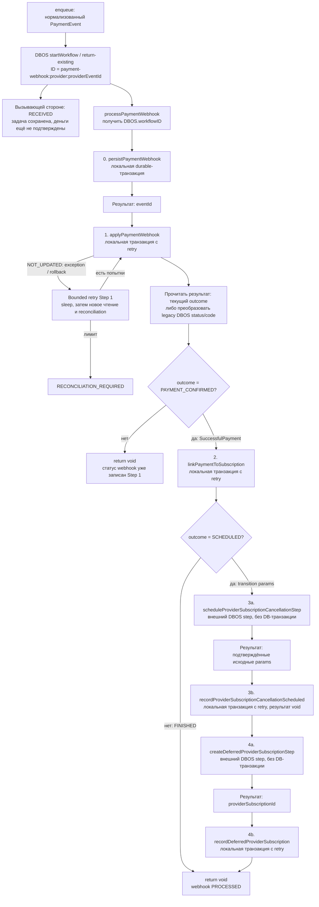

# Динамика C4: шаги и решения координатора

[Навигация](../../README.md) · [Компоненты](../component/payment-webhook.md)

| Операция | Что получает координатор | Как принимает решение | Детали |
| --- | --- | --- | --- |
| 0 | `eventId: string` | Перейти к финансовому шагу | [Сохранение](../../steps/persist-payment-webhook.md) |
| 1 | `PaymentEventResult` | Только `outcome=PAYMENT_CONFIRMED` продолжает в D2; остальные результаты завершают process | [Финансовый шаг](../../steps/apply-payment-event.md) |
| 2 | `FINISHED` или `SCHEDULED` с параметрами перехода | FINISHED → return; SCHEDULED → старый provider cancel и новый provider create | [Linking](../../steps/link-payment-to-subscription.md) |
| 3a | Исходные transition params после проверки ответа Stripe | Передать в 3b и затем 4a; новой бизнес-развилки нет | [Замена provider Subscription](../../steps/replace-provider-subscription.md) |
| 3b | `void` после commit | Можно создавать новую provider Subscription | [Замена provider Subscription](../../steps/replace-provider-subscription.md) |
| 4a | `{ providerSubscriptionId }` | Передать ID вместе с params в локальную фиксацию | [Замена provider Subscription](../../steps/replace-provider-subscription.md) |
| 4b | `void` после commit | Завершить process; webhook уже PROCESSED | [Замена provider Subscription](../../steps/replace-provider-subscription.md) |

Исключение не является бизнес-результатом из таблицы. Оно прерывает последовательность и попадает
в соответствующую [политику retry/failure](../../steps/retry-and-failure.md).
Успешный финансовый commit Step 1 не откатывается из-за последующего сбоя Step 2–4.
