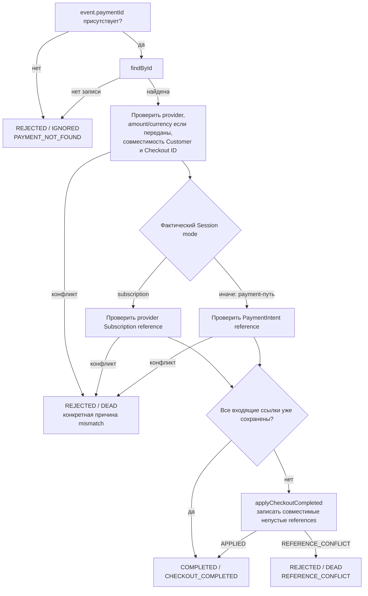

# Checkout Session Completed: enrichment

[К маршрутизации Step 1](../steps/apply-payment-event.md) ·
[К координатору](../c4/dynamic/payment-webhook.md) ·
[Код](../../../../apps/payments/src/features/payments/application/use-cases/payment-events/apply-checkout-session-completed/apply-checkout-session-completed.use-case.ts)

Диаграмма описывает текущий handler внутри переданного tx Step 1. Handler возвращает application result;
запись конечного webhook audit выполняет ApplyPaymentEventUseCase.finish.

Session mode определяет состав command, а не CheckoutPurpose. Для subscription передаются
Checkout/Customer/Subscription, для payment — Checkout/Customer/PaymentIntent. Invoice ID не участвует.
Наличие ссылки проверяется как знание: входящий null не очищает сохранённое значение.
Финансовый статус не меняется; completed Session не доказывает оплату.
Конфликты: PROVIDER_MISMATCH, AMOUNT_MISMATCH, CURRENCY_MISMATCH, CUSTOMER_MISMATCH, REFERENCE_CONFLICT.

COMPLETED → webhook PROCESSED; REJECTED → webhook IGNORED/DEAD по disposition.
Координатор завершает process, начисление доступа D2 не запускается.
Исключения не являются REJECTED: они откатывают tx и передаются в
[общую retry/error policy](../steps/retry-and-failure.md).
