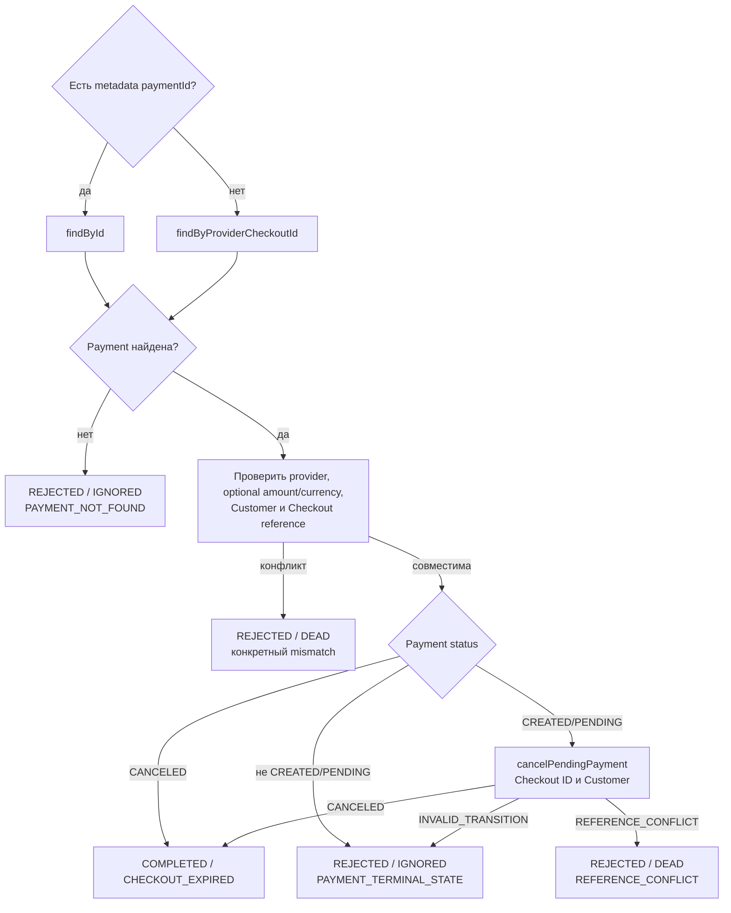

# Checkout Session Expired: отмена неоплаченной попытки

[К маршрутизации Step 1](../steps/apply-payment-event.md) ·
[К координатору](../c4/dynamic/payment-webhook.md) ·
[Код](../../../../apps/payments/src/features/payments/application/use-cases/payment-events/cancel-expired-checkout-session/cancel-expired-checkout-session.use-case.ts)

Диаграмма описывает текущий handler внутри переданного tx Step 1. Handler возвращает application result;
запись конечного webhook audit выполняет ApplyPaymentEventUseCase.finish.

Handler не выводит Stripe mode из CheckoutPurpose. Успешную Payment поздний expired не понижает.
Invoice/Subscription/PaymentIntent references этого события не участвуют в reconciliation.
Повтор уже отменённой совместимой Payment завершается CHECKOUT_EXPIRED без записи.

COMPLETED → webhook PROCESSED; REJECTED → webhook IGNORED/DEAD по disposition.
Координатор завершает process, начисление доступа D2 не запускается.
Исключения не являются REJECTED: они откатывают tx и передаются в
[общую retry/error policy](../steps/retry-and-failure.md).
