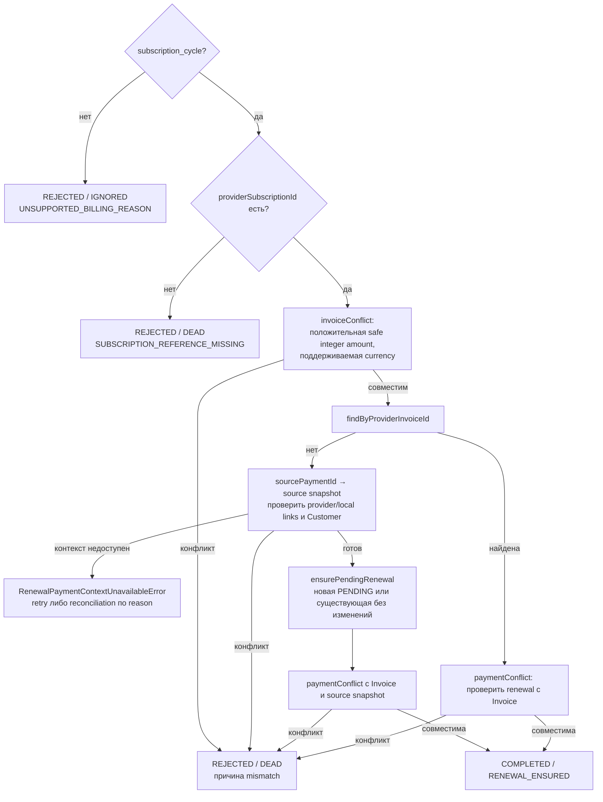

# Invoice Finalized: обеспечить pending renewal

[К маршрутизации Step 1](../steps/apply-payment-event.md) ·
[К координатору](../c4/dynamic/payment-webhook.md) ·
[Код](../../../../apps/payments/src/features/payments/application/use-cases/payment-events/ensure-renewal-payment/ensure-renewal-payment.use-case.ts)

Диаграмма описывает текущий handler внутри переданного tx Step 1. Handler возвращает application result;
запись конечного webhook audit выполняет ApplyPaymentEventUseCase.finish.

Новая Payment получает amount_due из Invoice, paidAt=null и providerPaymentId=null.
Существующая строка не перезаписывается. Для уже SUCCEEDED поздний finalized не сравнивает
amount_due с собранной суммой; до этой ветки всё равно проверяются provider, тип renewal,
локальная Subscription, provider references и currency. PaymentIntent на finalized не сохраняется.
Source предоставляет user/plan/period/local link: его type/status/paidAt и финансовые значения
не используются как критерии допустимости снимка. SOURCE_METADATA_MISSING требует reconciliation,
SOURCE_PAYMENT_NOT_FOUND и SOURCE_NOT_LINKED допускают bounded retry.

COMPLETED → webhook PROCESSED; REJECTED → webhook IGNORED/DEAD по disposition.
Координатор завершает process, начисление доступа D2 не запускается.
Исключения не являются REJECTED: они откатывают tx и передаются в
[общую retry/error policy](../steps/retry-and-failure.md).
