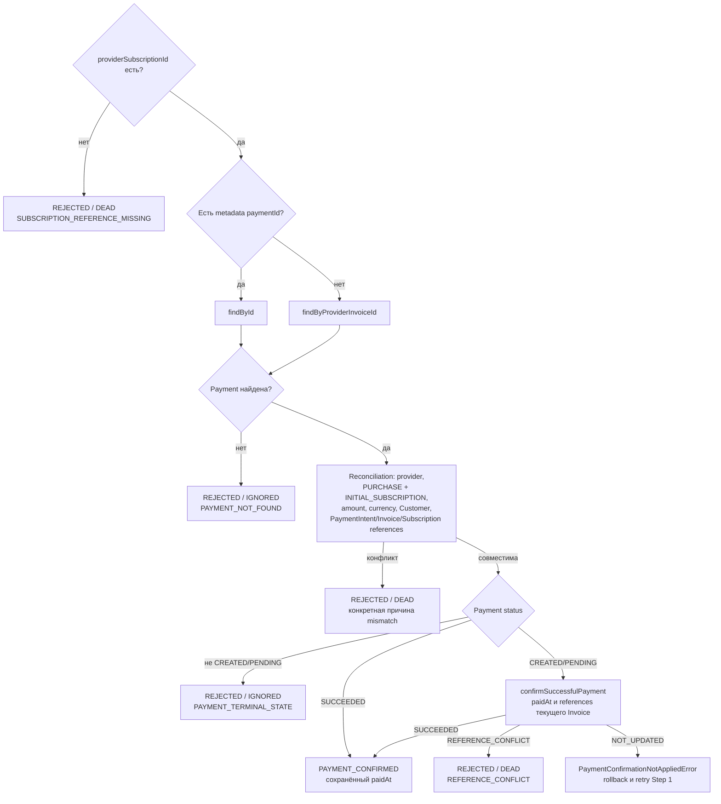

# Invoice Paid: первоначальная покупка

[К маршрутизации Step 1](../steps/apply-payment-event.md) ·
[К координатору](../c4/dynamic/payment-webhook.md) ·
[Код](../../../../apps/payments/src/features/payments/application/use-cases/payment-events/confirm-invoice-paid/confirm-invoice-paid.use-case.ts)

Диаграмма описывает текущий handler внутри переданного tx Step 1. Handler возвращает application result;
запись конечного webhook audit выполняет ApplyPaymentEventUseCase.finish.

Эта ветка не создаёт новую Payment: исходная PURCHASE создана Checkout-сценарием.
Если metadata ID передан, отсутствие записи по нему не запускает fallback по Invoice.
SUCCEEDED без paidAt нарушает инвариант и вызывает исключение фабрики результата.
Только успешный commit Step 1 позволяет координатору продолжить применение доступа.

PAYMENT_CONFIRMED оставляет webhook незавершённым: после commit координатор запускает Step 2.
COMPLETED → PROCESSED; REJECTED → IGNORED/DEAD по disposition, затем координатор завершает process.
Исключения не являются REJECTED: они откатывают tx и передаются в
[общую retry/error policy](../steps/retry-and-failure.md).
