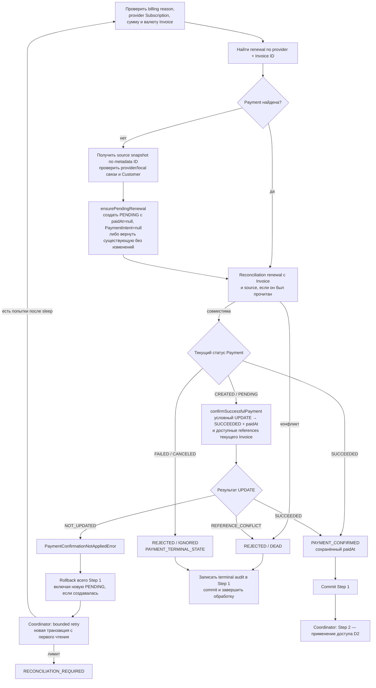

# Invoice Paid: автоматический renewal

[К маршрутизации Step 1](../steps/apply-payment-event.md) ·
[К координатору](../c4/dynamic/payment-webhook.md) ·
[Код](../../../../apps/payments/src/features/payments/application/use-cases/payment-events/confirm-renewal-payment/confirm-renewal-payment.use-case.ts)

Диаграмма описывает текущий handler внутри переданного tx Step 1. Handler возвращает application result;
запись конечного webhook audit выполняет ApplyPaymentEventUseCase.finish.

[Назад к Invoice Paid](./invoice-paid.md).

Вход: subscription_cycle, обязательный provider Subscription ID, положительная safe integer сумма
и поддерживаемая валюта. Ошибки этих проверок возвращают REJECTED / DEAD до поиска Payment.
Существующая renewal не требует source metadata. Для recovery source сравнивается с provider/local
связями; его type/status/paidAt не используются для доказательства новой оплаты.
Проверка полученной renewal включает provider, RENEWAL с checkoutPurpose=null, локальную Subscription,
согласованность с source при его чтении, references, amount и currency текущего Invoice.

Ошибки получения source и инфраструктурные исключения следуют общей
[политике retry/reconciliation](./retry-and-failure.md). Схема показывает отдельно NOT_UPDATED;
SOURCE_METADATA_MISSING сразу требует reconciliation, отсутствующий source или его связи допускают
bounded retry. Тип, статус и paidAt source не проверяются как условие чтения исторического снимка.

PAYMENT_CONFIRMED оставляет webhook незавершённым: после commit координатор запускает Step 2.
COMPLETED → PROCESSED; REJECTED → IGNORED/DEAD по disposition, затем координатор завершает process.
Исключения не являются REJECTED: они откатывают tx и передаются в
[общую retry/error policy](../steps/retry-and-failure.md).
