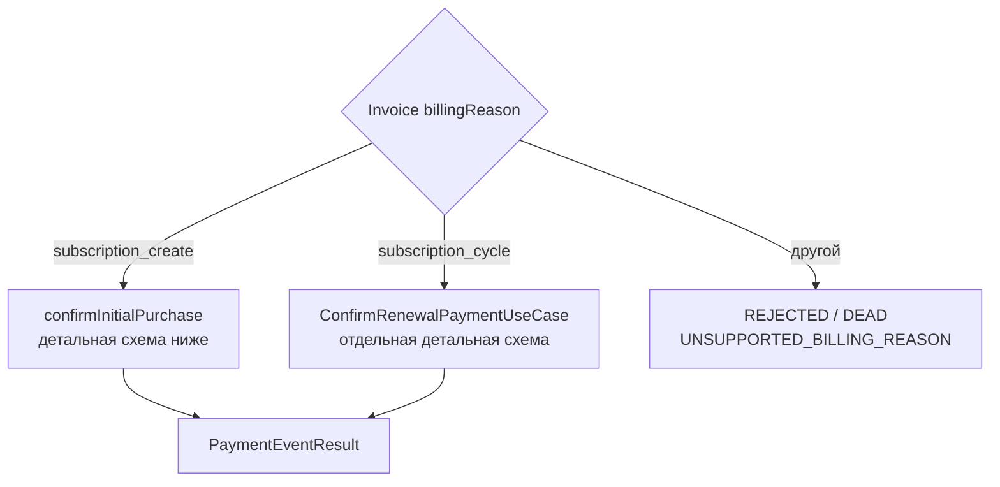

# Invoice Paid: маршрутизация initial и renewal

[К маршрутизации Step 1](../steps/apply-payment-event.md) ·
[К координатору](../c4/dynamic/payment-webhook.md) ·
[Код](../../../../apps/payments/src/features/payments/application/use-cases/payment-events/confirm-invoice-paid/confirm-invoice-paid.use-case.ts)

Диаграмма описывает текущий handler внутри переданного tx Step 1. Handler возвращает application result;
запись конечного webhook audit выполняет ApplyPaymentEventUseCase.finish.

Перейти к [первой покупке](./invoice-paid-initial.md) или к
[автоматическому renewal](./invoice-paid-renewal.md). В отличие от finalized и voided,
неподдерживаемый billing reason здесь даёт DEAD, а не IGNORED.

PAYMENT_CONFIRMED оставляет webhook незавершённым: после commit координатор запускает Step 2.
COMPLETED → PROCESSED; REJECTED → IGNORED/DEAD по disposition, затем координатор завершает process.
Исключения не являются REJECTED: они откатывают tx и передаются в
[общую retry/error policy](../steps/retry-and-failure.md).
