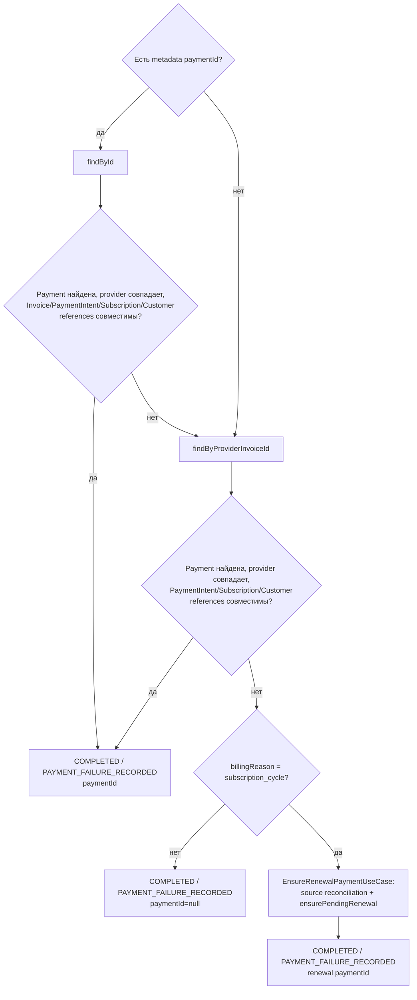

# Invoice Payment Failed: безопасная correlation

[К маршрутизации Step 1](../steps/apply-payment-event.md) ·
[К координатору](../c4/dynamic/payment-webhook.md) ·
[Код](../../../../apps/payments/src/features/payments/application/use-cases/payment-events/record-invoice-payment-failed/record-invoice-payment-failed.use-case.ts)

Диаграмма описывает текущий handler внутри переданного tx Step 1. Handler возвращает application result;
запись конечного webhook audit выполняет ApplyPaymentEventUseCase.finish.

В отличие от PaymentIntent failure handler, отсутствие совместимого Payment для обычного Invoice не
означает IGNORED/DEAD: событие успешно завершается без привязки. Для `subscription_cycle` отсутствие
renewal запускает тот же recovery, что `invoice.finalized`: по source metadata идемпотентно создаётся
`PENDING RENEWAL` с уникальным provider Invoice. Fallback по Subscription ID отсутствует. Существующий
`PENDING`, `SUCCEEDED` или `CANCELED` Payment не перезаписывается и не понижается. Legacy event без
amount/currency требует reconciliation с `RENEWAL_INVOICE_CONTEXT_MISSING`.

Failure не переводит Payment в `FAILED`: Stripe всё ещё может повторить взыскание. Отдельная таблица
истории попыток не записывается. Корреляция не доказывает окончательную невозможность оплаты Invoice.

COMPLETED → webhook PROCESSED; REJECTED → webhook IGNORED/DEAD по disposition.
Координатор завершает process, начисление доступа D2 не запускается.
Исключения не являются REJECTED: они откатывают tx и передаются в
[общую retry/error policy](../steps/retry-and-failure.md).
