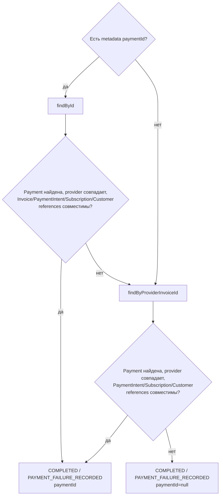

# Invoice Payment Failed: безопасная correlation

[К маршрутизации Step 1](../steps/apply-payment-event.md) ·
[К координатору](../c4/dynamic/payment-webhook.md) ·
[Код](../../../../apps/payments/src/features/payments/application/use-cases/payment-events/record-invoice-payment-failed/record-invoice-payment-failed.use-case.ts)

Диаграмма описывает текущий handler внутри переданного tx Step 1. Handler возвращает application result;
запись конечного webhook audit выполняет ApplyPaymentEventUseCase.finish.

В отличие от PaymentIntent failure handler, отсутствие совместимого Payment здесь не означает
IGNORED/DEAD: событие успешно завершается без привязки. Несовместимая metadata-кандидатура не
мешает fallback по Invoice ID. Fallback по Subscription ID в текущем коде отсутствует.
Payment не создаётся и его статус не меняется. Отдельная таблица истории попыток не записывается.
Корреляция не доказывает окончательную невозможность оплаты Invoice.

COMPLETED → webhook PROCESSED; REJECTED → webhook IGNORED/DEAD по disposition.
Координатор завершает process, начисление доступа D2 не запускается.
Исключения не являются REJECTED: они откатывают tx и передаются в
[общую retry/error policy](../steps/retry-and-failure.md).
