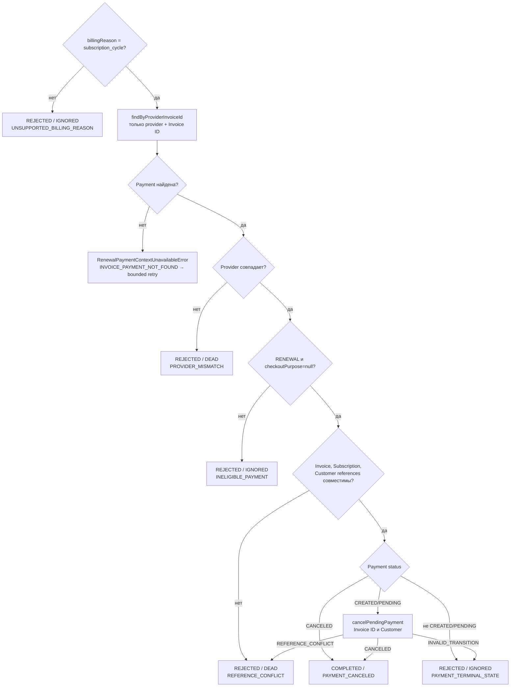

# Invoice Voided: отмена unpaid renewal

[К маршрутизации Step 1](../steps/apply-payment-event.md) ·
[К координатору](../c4/dynamic/payment-webhook.md) ·
[Код](../../../../apps/payments/src/features/payments/application/use-cases/payment-events/cancel-voided-invoice/cancel-voided-invoice.use-case.ts)

Диаграмма описывает текущий handler внутри переданного tx Step 1. Handler возвращает application result;
запись конечного webhook audit выполняет ApplyPaymentEventUseCase.finish.

Metadata paymentId не используется для выбора отменяемой Payment: он может указывать на source.
Отсутствующая renewal не создаётся этим handler; ожидается другой workflow, например finalized.
Уже успешная Payment не отменяется. Никаких изменений lifecycle локальной Subscription здесь нет.

COMPLETED → webhook PROCESSED; REJECTED → webhook IGNORED/DEAD по disposition.
Координатор завершает process, начисление доступа D2 не запускается.
Исключения не являются REJECTED: они откатывают tx и передаются в
[общую retry/error policy](../steps/retry-and-failure.md).
