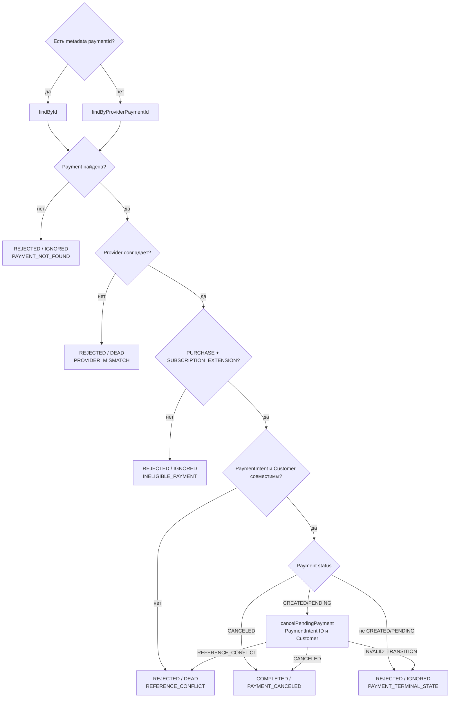

# PaymentIntent Canceled: terminal cancellation extension

[К маршрутизации Step 1](../steps/apply-payment-event.md) ·
[К координатору](../c4/dynamic/payment-webhook.md) ·
[Код](../../../../apps/payments/src/features/payments/application/use-cases/payment-events/cancel-payment-intent/cancel-payment-intent.use-case.ts)

Диаграмма описывает текущий handler внутри переданного tx Step 1. Handler возвращает application result;
запись конечного webhook audit выполняет ApplyPaymentEventUseCase.finish.

Initial purchase и renewal исключены через INELIGIBLE_PAYMENT. Сумма и валюта в этом handler
не проверяются: событие доказывает закрытие конкретного PaymentIntent. Несовместимый Customer
здесь даёт REFERENCE_CONFLICT, а не отдельный CUSTOMER_MISMATCH. Отмена не означает refund.

COMPLETED → webhook PROCESSED; REJECTED → webhook IGNORED/DEAD по disposition.
Координатор завершает process, начисление доступа D2 не запускается.
Исключения не являются REJECTED: они откатывают tx и передаются в
[общую retry/error policy](../steps/retry-and-failure.md).
