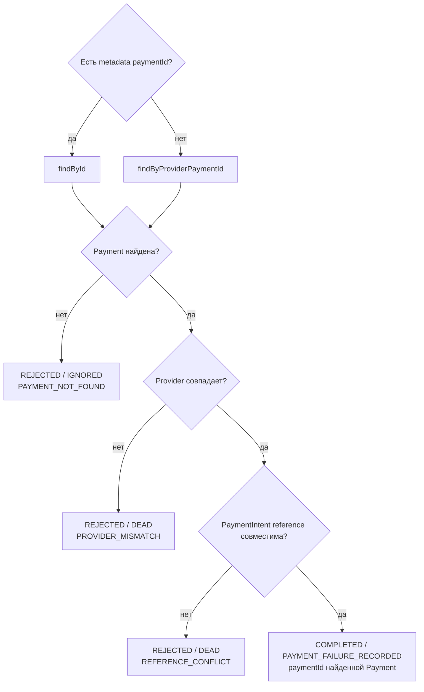

# PaymentIntent Payment Failed: correlation попытки

[К маршрутизации Step 1](../steps/apply-payment-event.md) ·
[К координатору](../c4/dynamic/payment-webhook.md) ·
[Код](../../../../apps/payments/src/features/payments/application/use-cases/payment-events/record-payment-intent-failed/record-payment-intent-failed.use-case.ts)

Диаграмма описывает текущий handler внутри переданного tx Step 1. Handler возвращает application result;
запись конечного webhook audit выполняет ApplyPaymentEventUseCase.finish.

PaymentType/CheckoutPurpose и lifecycle status не ограничиваются. Customer, сумма и валюта
не участвуют в проверках этого handler. Он не меняет Payment и не создаёт отдельную финансовую
историю попыток: PAYMENT_FAILURE_RECORDED обозначает завершённую обработку события для webhook audit.
Отдельная неудачная попытка не означает FAILED; поздний success остаётся допустимым.

COMPLETED → webhook PROCESSED; REJECTED → webhook IGNORED/DEAD по disposition.
Координатор завершает process, начисление доступа D2 не запускается.
Исключения не являются REJECTED: они откатывают tx и передаются в
[общую retry/error policy](../steps/retry-and-failure.md).
