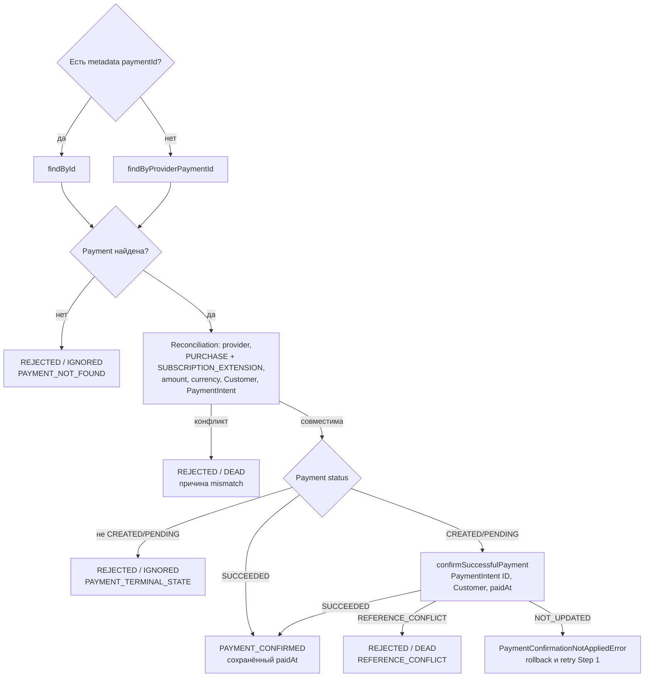

# PaymentIntent Succeeded: одноразовая extension

[К маршрутизации Step 1](../steps/apply-payment-event.md) ·
[К координатору](../c4/dynamic/payment-webhook.md) ·
[Код](../../../../apps/payments/src/features/payments/application/use-cases/payment-events/confirm-payment-intent-succeeded/confirm-payment-intent-succeeded.use-case.ts)

Диаграмма описывает текущий handler внутри переданного tx Step 1. Handler возвращает application result;
запись конечного webhook audit выполняет ApplyPaymentEventUseCase.finish.

Metadata ID имеет приоритет; fallback по PaymentIntent используется только при отсутствии metadata,
а не после неудачного metadata-поиска. В этом событии не проверяются Subscription/Invoice references.
Initial purchase и renewal через PaymentIntent success не подтверждаются: PURPOSE_MISMATCH.
SUCCEEDED требует paidAt; фабрика результата выбросит ошибку при нарушении инварианта.
При NOT_UPDATED дополнительного SELECT нет: вся попытка откатывается, следующая начинает с первого чтения.

PAYMENT_CONFIRMED оставляет webhook незавершённым: после commit координатор запускает Step 2.
COMPLETED → PROCESSED; REJECTED → IGNORED/DEAD по disposition, затем координатор завершает process.
Исключения не являются REJECTED: они откатывают tx и передаются в
[общую retry/error policy](../steps/retry-and-failure.md).
