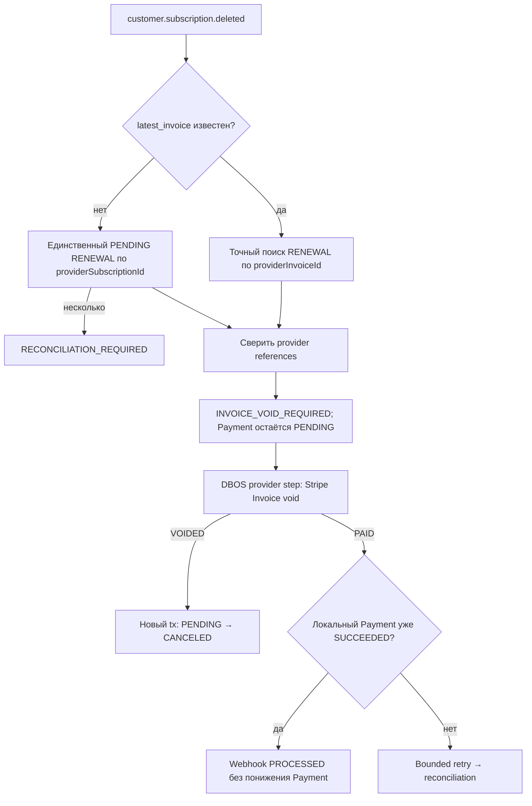

# customer.subscription.deleted

[Код подготовки](../../../../apps/payments/src/features/payments/application/use-cases/payment-events/prepare-canceled-subscription-renewal/prepare-canceled-subscription-renewal.use-case.ts) ·
[Код provider/finalize](../../../../apps/payments/src/features/payments/application/use-cases/process-payment-webhook/close-canceled-subscription-invoice.use-case.ts)

Stripe может перевести Subscription в `canceled` после исчерпания Smart Retries, оставив последний
Invoice в `open`. Поэтому `invoice.voided` не является гарантированным исходным terminal-сигналом.

Provider-вызов выполняется вне Prisma transaction. Идемпотентность Stripe-команды привязана к
Invoice: `invoice:void:<providerInvoiceId>`. Локальный Payment отменяется только после `VOIDED`.
Параллельный `invoice.voided`, который уже отменил Payment, принимается идемпотентно.

Cleanup разрешён только для `PaymentType.RENEWAL + checkoutPurpose=null`; initial `PURCHASE` не
отменяется. При `PAID` событие ждёт, пока `invoice.paid` переведёт Payment в `SUCCEEDED`.
