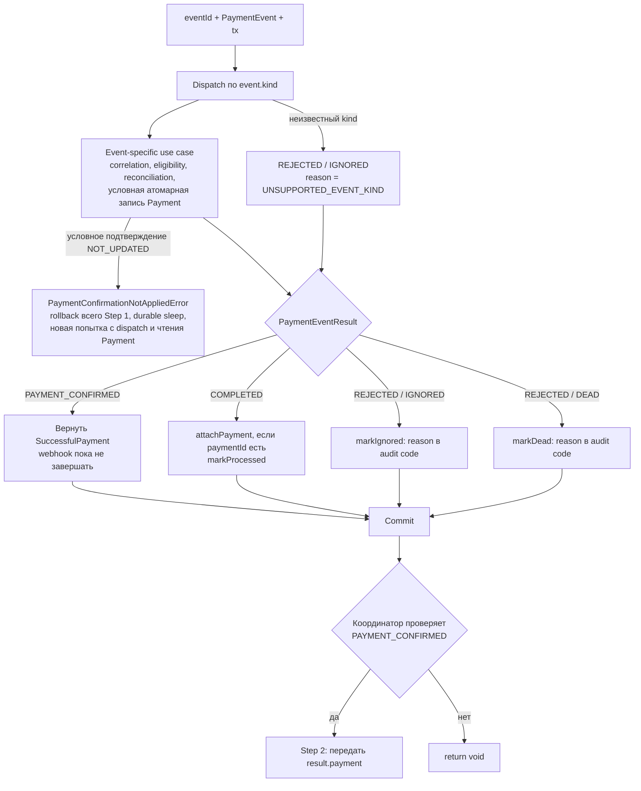

# Шаг 1: финансовая обработка события

[К координатору](../c4/dynamic/payment-webhook.md) ·
[Код](../../../../apps/payments/src/features/payments/application/use-cases/process-payment-webhook/apply-payment-event.use-case.ts)

Вход: `{ eventId, event }` и новый локальный tx. До попытки координатор отдельно записывает
`recordPaymentWebhookAttempt`; rollback бизнес-транзакции не стирает номер попытки.

| Событие | Handler | Назначение успешного пути |
| --- | --- | --- |
| checkout.session.completed | [ApplyCheckoutSessionCompletedUseCase](../handlers/checkout-session-completed.md) | Enrichment; CHECKOUT_COMPLETED, без доказательства оплаты |
| checkout.session.expired | [CancelExpiredCheckoutSessionUseCase](../handlers/checkout-session-expired.md) | Допустимая отмена; CHECKOUT_EXPIRED |
| payment_intent.succeeded | [ConfirmPaymentIntentSucceededUseCase](../handlers/payment-intent-succeeded.md) | Успех one-time extension; PAYMENT_CONFIRMED |
| invoice.finalized | [EnsureRenewalPaymentUseCase](../handlers/invoice-finalized.md) | Pending renewal; RENEWAL_ENSURED |
| invoice.paid | [ConfirmInvoicePaidUseCase](../handlers/invoice-paid.md) | Initial purchase или renewal; PAYMENT_CONFIRMED |
| payment_intent.payment_failed | [RecordPaymentIntentFailedUseCase](../handlers/payment-intent-payment-failed.md) | Audit/correlation; PAYMENT_FAILURE_RECORDED |
| payment_intent.canceled | [CancelPaymentIntentUseCase](../handlers/payment-intent-canceled.md) | Допустимая terminal cancellation; PAYMENT_CANCELED |
| invoice.payment_failed | [RecordInvoicePaymentFailedUseCase](../handlers/invoice-payment-failed.md) | Audit/correlation; PAYMENT_FAILURE_RECORDED |
| invoice.voided | [CancelVoidedInvoiceUseCase](../handlers/invoice-voided.md) | Отмена unpaid renewal; PAYMENT_CANCELED |

Таблица показывает назначение handlers, а не обещает COMPLETED/PAYMENT_CONFIRMED для любого входящего payload:
они могут вернуть REJECTED с disposition IGNORED/DEAD либо выбросить ошибку. Правила отдельных событий — в
[README event slices](../../../../apps/payments/src/features/payments/application/use-cases/payment-events/README.md).

Контракт результата:

- `outcome=PAYMENT_CONFIRMED`: сериализуемый `SuccessfulPayment` для Step 2; paymentId хранится внутри snapshot.
- `COMPLETED`: `paymentId: string | null`, без payment snapshot.
- `REJECTED`: `reason: PaymentEventRejectionReason` и `disposition: IGNORED | DEAD`, без payment snapshot.
- `COMPLETED.code` имеет тип PaymentEventCompletionCode; причины отклонения в него не входят.

Координатор не интерпретирует каждый conflict code: завершение по бизнес-результату принадлежит
ApplyPaymentEventUseCase.finish. Исключение откатывает транзакцию и идёт в [retry](./retry-and-failure.md).

Для replay уже сохранённого результата координатор использует infrastructure mapper:
старый SUCCESS/PAYMENT_SUCCEEDED становится PAYMENT_CONFIRMED, другой SUCCESS — COMPLETED,
IGNORED/DEAD — REJECTED с прежней disposition и reason. Mapper не добавляет durable-операций.

confirmSuccessfulPayment при NOT_UPDATED не перечитывает строку. Обработчики initial/extension/renewal
выбрасывают PAYMENT_CONFIRMATION_NOT_APPLIED; coordinator повторяет Step 1 целиком. Успех,
terminal state и conflict определяются при первом чтении новой попытки. При отсутствии renewal
применяется Invoice recovery. На лимите попыток webhook получает RECONCILIATION_REQUIRED.

Recovery invoice.paid при отсутствии renewal использует ensurePendingRenewal: создать PENDING
либо вернуть существующую запись без изменений. Затем reconciliation и условное подтверждение
в том же tx. Отдельного создания сразу SUCCEEDED больше нет; ошибка подтверждения откатывает
новую строку, а не оставляет незавершённую PENDING отдельным commit.

## Детализация обработчиков

Все имена handlers в таблице выше — ссылки на отдельные диаграммы.
Invoice Paid дополнительно раскрывается в [initial purchase](../handlers/invoice-paid-initial.md)
и [renewal](../handlers/invoice-paid-renewal.md). В диаграммах показано поведение текущего кода,
включая различия между IGNORED, DEAD, COMPLETED и исключениями для retry.
