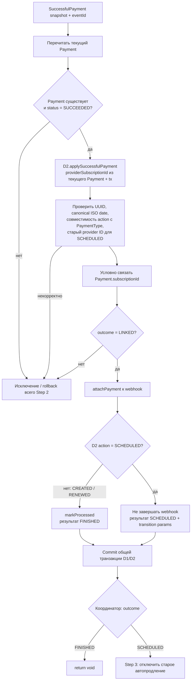

# Шаг 2: применение доступа и linking

[К координатору](../c4/dynamic/payment-webhook.md) ·
[Код](../../../../apps/payments/src/features/payments/application/use-cases/process-payment-webhook/link-payment-to-subscription.use-case.ts)

Вход: `{ eventId, payment: SuccessfulPayment }` и новый tx. Внутренний процесс D2 не раскрывается;
D1 требует идемпотентного применения по paymentId в переданной общей транзакции.

D2 возвращает `subscriptionId`, `action`, `nextSubscriptionStartsAt`, `previousProviderSubscriptionId`.
D1 преобразует этот ответ в собственный `LinkPaymentToSubscriptionResult`:

| Результат | Содержимое | Решение координатора |
| --- | --- | --- |
| FINISHED | Только outcome | Вернуть управление; доступ и webhook уже зафиксированы |
| SCHEDULED | eventId, payment snapshot, subscriptionId, nextSubscriptionStartsAt, previousProviderSubscriptionId | Запустить оба provider-шага |

Для SCHEDULED `nextSubscriptionStartsAt` — конец всей уже оплаченной цепочки, включая новую покупку:
это время первого будущего provider billing, не начало добавленного локального периода.
Конфликт Payment linking откатывает и начисление D2 в этом шаге; финансовый commit Step 1 сохраняется.
Адаптация D2 к действующим портам — отдельная работа другого разработчика.
