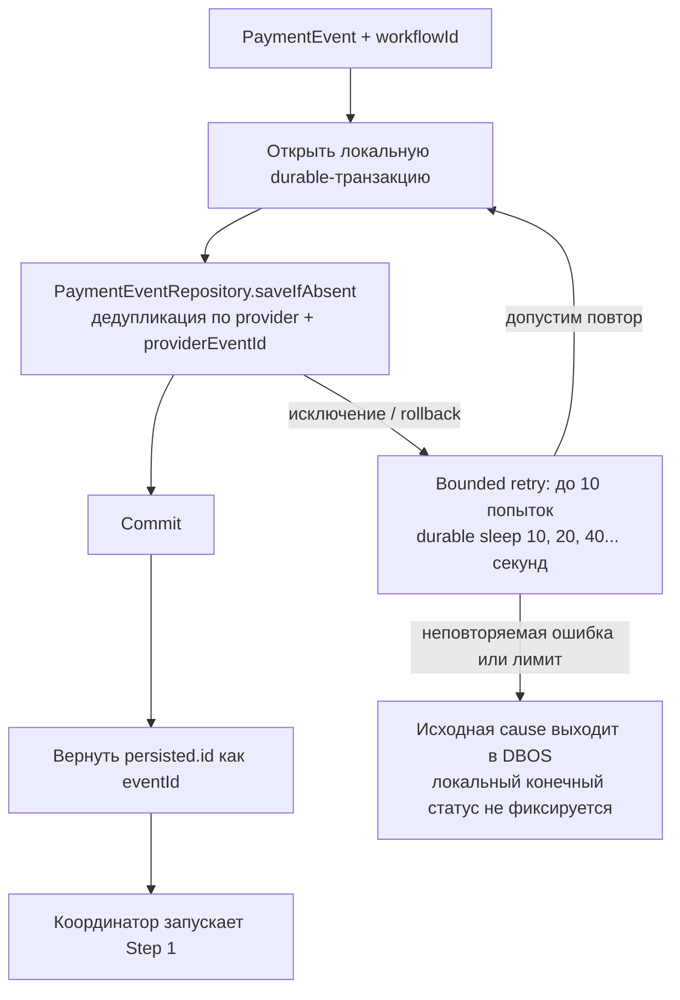

# Шаг 0: сохранить webhook

[К координатору](../c4/dynamic/payment-webhook.md)

Вход: нормализованный `PaymentEvent` и `workflowId`. Метод `persistPaymentEventStep`
вызывает `saveIfAbsent` в datasource-транзакции `persistPaymentWebhook`.

Результат — идентификатор inbox-записи, а не Payment и не признак оплаты.
Операция выполняется до основного try/catch process: при ошибке нет подтверждённого eventId,
по которому координатор мог бы безопасно записать DEAD или RECONCILIATION_REQUIRED.
Отсутствующий DBOS.workflowID вызывает исключение ещё до этого шага.
