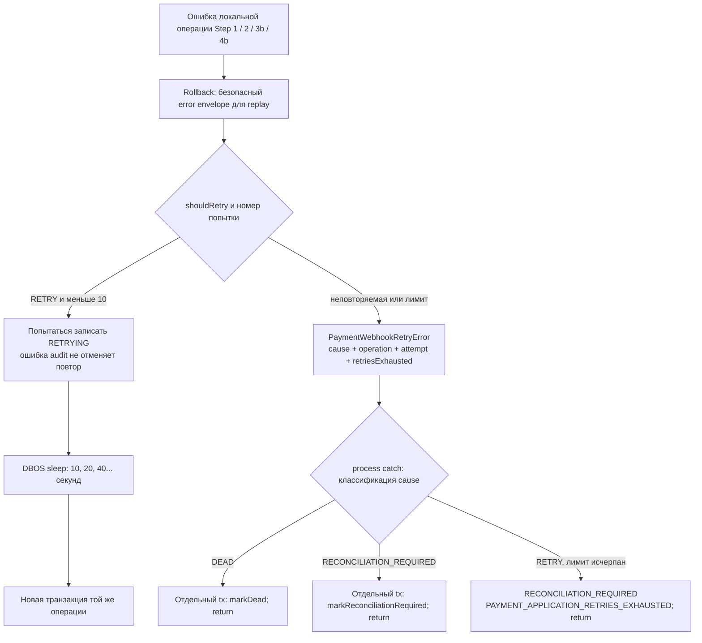

# Retry и завершение при ошибке

[К координатору](../c4/dynamic/payment-webhook.md) ·
[Классификация ошибок](../../../../apps/payments/src/features/payments/infrastructure/dbos/payment-workflow-error.policy.ts)

Бизнес-результат REJECTED с disposition DEAD/IGNORED из Step 1 и выброшенное исключение — разные пути.
Ниже показаны исключения. Классификатор возвращает disposition и безопасную audit failure;
сам retry helper статусы webhook не выбирает.

| Источник | Механизм | Исход |
| --- | --- | --- |
| Inbox persist до основного try | Helper, до 10 попыток | При неуспехе исходная cause выходит в DBOS, локальный финальный статус не пишется |
| Локальная операция | Helper, до 10 попыток, каждая в новом tx | DEAD либо RECONCILIATION_REQUIRED согласно схеме |
| Provider 3a / 4a | @DBOS.step, до 10 попыток, начальный интервал 10 секунд, backoff 2, shouldRetry | Ошибка после step-политики идёт в общий catch без helper wrapper |
| Финальная запись DEAD/reconciliation | Отдельная datasource-транзакция | Её ошибка выходит наружу, не переклассифицируется как ошибка платёжной операции |
| Восстановление всего workflow | maxRecoveryAttempts=10 | Отдельный лимит DBOS; не совпадает с числом попыток операции; DLQ audit reconciliation отдельно не реализован |

Для ошибки вне PaymentWebhookRetryError общий catch вызывает recordWorkflowFailure:
RETRY → markRetrying и повторно выбросить ошибку в DBOS; остальные disposition → markDead и return.
В частности, DBOSMaxStepRetriesError классифицируется DEAD с DBOS_STEP_RETRIES_EXHAUSTED.
Эта ветка не переводит RECONCILIATION_REQUIRED в одноимённый статус: такое преобразование есть
только в ветке helper wrapper. Здесь показано текущее поведение кода, а не универсальная целевая политика.
Запись RETRYING сама по себе не планирует выполнение.

## Почему ошибка допускает retry

RETRY означает «повтор может восстановить обработку», а не «доказано, что ошибка временная».
Мы различаем три основания:

1. Зависимость временно недоступна: повтор читает актуальное состояние в новой транзакции.
2. События пришли не по порядку: нужная Payment или её привязка может появиться после другого workflow.
3. Внешний исход неизвестен: запрос мог выполниться, поэтому повтор использует ту же идентичность
   операции и provider idempotency key. Новый запрос с новым ключом может создать второй внешний эффект.

Повтор ограничен: неизменившаяся ошибка не удерживает application loop бесконечно.
Rollback защищает локальные изменения, но не отменяет уже выполненный Stripe-вызов.
RECONCILIATION_REQUIRED относится к webhook, сохраняет processedAt=null и не отменяет SUCCEEDED Payment.

## Исключения с disposition RETRY

Классификация PaymentsError выполняется по code, не по имени класса и не по тексту message.
Ниже перечислен весь RETRY allowlist из payment-workflow-error.policy.ts.

| Исключение / code | Значение | Почему выбран retry и его границы |
| --- | --- | --- |
| PaymentProviderUnavailableError / PAYMENT_PROVIDER_UNAVAILABLE | Провайдер недоступен для операции | Доступность может восстановиться. Stripe mapper относит сюда API errors, rate limit, authentication и permission errors. Последние два случая часто требуют исправления конфигурации; retry — ограниченное ожидание восстановления, а не обещание самовосстановления credentials |
| PaymentProviderOutcomeUnknownError / PAYMENT_PROVIDER_OUTCOME_UNKNOWN | Неизвестно, принял ли провайдер mutating request | Соединение могло оборваться после выполнения. Нельзя считать операцию отменённой; повторяется та же операция с устойчивой idempotency identity |
| PaymentsError с PAYMENT_CUSTOMER_PROVIDER_FAILED | Ошибка provider-операции с Customer | Код оставлен в общем allowlist как восстанавливаемая ошибка зависимости. Это не доказательство отдельного активного пути исключения в текущих Step 1–4: конкретные Stripe errors сейчас нормализует provider mapper |
| PaymentSubscriptionContextError / PAYMENT_SUBSCRIPTION_CONTEXT_FAILED | Не удалось прочитать контекст подписки для покупки | Ошибка чтения не равна отсутствию подписки; зависимость может восстановиться. Используется при создании Checkout, а не как обычный результат текущего webhook workflow |
| PaymentPlanUnavailableError / PAYMENT_PLAN_UNAVAILABLE | План временно недоступен | Временную недоступность нельзя трактовать как окончательное отсутствие плана. Код включён в общую policy; его присутствие не означает вызов чтения Plan в каждом webhook step |
| PaymentPersistenceError / PAYMENT_PERSISTENCE_FAILED | Локальная операция не смогла надёжно завершить persistence/reconciliation | Повтор в новом tx позволяет восстановиться после сбоя или конкурентного изменения. Не означает только «БД выключена»; несовпадение условного подтверждения теперь имеет отдельную ошибку PAYMENT_CONFIRMATION_NOT_APPLIED |
| PaymentConfirmationNotAppliedError / PAYMENT_CONFIRMATION_NOT_APPLIED | Условный UPDATE подтверждения не изменил строку | RETRY всего финансового шага: rollback и новое чтение вместо дополнительного SELECT и повторной reconciliation в той же попытке. Статус/references могли измениться после первого чтения; причина несовпадения заранее не утверждается |
| Любое нераспознанное исключение / UNEXPECTED_WORKFLOW_ERROR | Причина ещё не классифицирована, в том числе необёрнутая ошибка адаптера/БД | Защитное решение: неизвестность не должна немедленно терять событие. Не утверждает, что причина временная: программный дефект тоже попадёт сюда. После лимита локальных попыток нужна reconciliation, диагностика — по runtime logs |

Сырой SQL/provider message не сохраняется в webhook audit: туда попадают стабильный код и безопасное
сообщение. Классификатор не анализирует SQLSTATE неизвестной SQL-ошибки и не определяет повторяемость
по фрагментам текста. Известный PaymentsError вне allowlist, напротив, получает DEAD.

## RenewalPaymentContextUnavailableError: решение по reason

Это отдельная application-ошибка с code RENEWAL_PAYMENT_CONTEXT_UNAVAILABLE. Классификатор проверяет
её раньше общего PaymentsError и формирует audit code `RENEWAL_<reason>`.

| reason | Значение / место возникновения | Решение | Почему |
| --- | --- | --- | --- |
| SOURCE_PAYMENT_NOT_FOUND | Исходная PURCHASE из sourcePaymentId ещё не найдена при finalized/paid | RETRY | Обработка связанных событий или commit исходной покупки могли запоздать. Повтор перечитает БД; неверный ID сам не исправится, поэтому ожидание ограничено |
| SOURCE_NOT_LINKED | У исходной оплаты ещё нет необходимых local/provider Subscription links | RETRY | Финансовое подтверждение и linking — разные транзакции; другой workflow может завершить linking позже |
| INVOICE_PAYMENT_NOT_FOUND | invoice.voided не нашёл локальную renewal по provider + providerInvoiceId | RETRY | voided мог обогнать finalized, который создаёт renewal. Нельзя отменять source PURCHASE вместо отсутствующей renewal. Здесь Invoice Payment означает локальную Payment для Invoice, не Stripe InvoicePayment object |
| SOURCE_METADATA_MISSING | Для создания renewal отсутствует sourcePaymentId в нормализованном событии | RECONCILIATION_REQUIRED | Повтор того же неизменяемого события не добавит metadata. Нужны разбор источника/восстановление и отдельный replay, автоматический backfill не реализован |

В локальном helper-пути три retryable reason после исчерпания попыток переходят в
RECONCILIATION_REQUIRED с PAYMENT_APPLICATION_RETRIES_EXHAUSTED; последняя безопасная причина
включается в audit message. SOURCE_METADATA_MISSING не ждёт лимит: повтор неизменённой операции
не является выбранным способом восстановления.

## Исключения без автоматического application retry

| Исключение / code | Значение | Решение и основание |
| --- | --- | --- |
| PaymentProviderValidationError / PAYMENT_PROVIDER_VALIDATION_FAILED | Stripe отклонил запрос; mapper включает InvalidRequest, Idempotency и Card errors | DEAD для данного workflow. Неизменённый запрос не исправит параметры. Это ошибка выполнения provider-операции, а не правило «любой отказ карты делает Payment FAILED» |
| PaymentProviderResultMismatchError / PAYMENT_PROVIDER_RESULT_MISMATCH | Ответ не подтвердил нужный provider ID/desired state или вернул пустой ID | DEAD. Нельзя считать такой ответ подтверждением и продолжать следующий шаг; ожидание само по себе не исправляет противоречивый результат |
| PaymentSubscriptionApplicationConflictError / PAYMENT_SUBSCRIPTION_APPLICATION_CONFLICT | Несовместимый Payment state, некорректный D2 result, конфликт local/provider linking либо отсутствие Customer для создания новой Subscription | DEAD. Подготовленные данные нарушают контракт/инвариант; повтор без изменения причины не является разрешённым восстановлением |
| PaymentNotFoundError / PAYMENT_NOT_FOUND в Step 2 | Уже подтверждённая Payment из snapshot не найдена при linking | DEAD по текущей общей policy. Здесь ожидается существующая запись после commit Step 1; это отличается от ожидания source-контекста renewal |
| Другой известный PaymentsError вне RETRY allowlist | Ошибка имеет явный application/business code, не разрешённый для повтора | DEAD по умолчанию. Добавление нового кода требует осознанного решения policy; сама наследуемость от PaymentsError не делает ошибку временной |
| DBOSMaxStepRetriesError / DBOS_STEP_RETRIES_EXHAUSTED | DBOS исчерпал retry policy внешнего provider step | DEAD. Повторы уже выполнены; coordinator не начинает второй application retry loop поверх исчерпанного provider step |

DEAD означает остановку обработки webhook. Ни одна из этих классификаций сама по себе
не переводит финансовый Payment в FAILED/CANCELED и не откатывает успешно оплаченный период.
Ошибки D2 здесь учитываются только через application-границу и общий PaymentsError rule;
внутренняя классификация D2 не является предметом этого документа.

## Технические обёртки и исключения вне бизнес-шага

| Исключение | Что содержит / где возникает | Как используется |
| --- | --- | --- |
| PaymentWorkflowAttemptError | Безопасное disposition + failure перед rollback локального tx | Сохраняет классификацию при DBOS replay, когда prototype исходного исключения может потеряться. read проверяется первой; повторно причина по тексту не угадывается |
| PaymentWebhookRetryError | cause, operation, attempt, retriesExhausted | Helper сообщает coordinator, какая операция остановилась. Это не самостоятельная бизнес-причина. retriesExhausted=true только для повторяемой ошибки на последней попытке |
| MissingDbosWorkflowContextError | process вызван без DBOS.workflowID | Возникает до inbox и основного catch; выходит наружу без локальной записи DEAD/reconciliation. Это неправильный запуск, а не обычный application retry |
| PaymentWebhookEnqueueUnavailableError | Не удалось durable enqueue до process | Возвращается application/presentation boundary как HTTP 503 для повторной доставки Stripe. Не обрабатывается внутренним retry loop process |
| Ошибка записи финального audit | Не удалось сохранить DEAD/reconciliation | Выходит наружу: нельзя считать финальный статус сохранённым или маскировать ошибку записи прежней бизнес-причиной |

## Примеры решения координатора

- invoice.paid пришёл до linking исходной PURCHASE: SOURCE_NOT_LINKED → rollback → durable sleep →
  новый tx. После появления связи reconciliation продолжается.
- В Invoice нет source metadata: SOURCE_METADATA_MISSING → RECONCILIATION_REQUIRED сразу.
  Девять дополнительных повторов не изменили бы сохранённый payload.
- Stripe создал Subscription, но соединение оборвалось: OUTCOME_UNKNOWN → повтор внешнего step
  с прежней idempotency identity. Нельзя создавать новую логическую операцию.
- Stripe вернул ID другой Subscription: RESULT_MISMATCH → DEAD; следующий provider/local шаг
  не выполняется.
- Неизвестная SQL-ошибка: RETRY как защитная политика; если все локальные попытки неуспешны,
  RECONCILIATION_REQUIRED. Нужна диагностика, временность ошибки этим не доказана.

Основания выше объясняют текущую policy по коду и принятой модели восстановления; они не означают,
что каждый provider/DB failure доказан интеграционным тестом. Лимиты и ветки ошибок на этой странице
не меняют реализацию.

Исходники: [renewal context error](../../../../apps/payments/src/features/payments/application/errors/renewal-payment-context-unavailable.error.ts),
[provider errors](../../../../apps/payments/src/features/payments/application/errors/payment-provider.error.ts),
[Stripe error mapper](../../../../apps/payments/src/features/payments/infrastructure/stripe/stripe-payment-error.mapper.ts),
[retry helper](../../../../apps/payments/src/features/payments/infrastructure/dbos/dbos-payment-webhook-retry.service.ts),
[coordinator](../../../../apps/payments/src/features/payments/infrastructure/dbos/dbos-payment-webhook.workflow.ts).

## NOT_UPDATED: повтор вместо дополнительного чтения

Это правило применяется к one-time extension, initial invoice и automatic renewal.
Репозиторий возвращает только NOT_UPDATED, не определяя business outcome. Application выбрасывает
PaymentConfirmationNotAppliedError; coordinator откатывает финансовую транзакцию и повторяет весь
Step 1 после durable sleep. При новом чтении SUCCEEDED даёт PAYMENT_CONFIRMED с прежним paidAt,
terminal state и conflicts обрабатываются исходными проверками. Если renewal отсутствует,
работает обычный recovery по Invoice; PAYMENT_DISAPPEARED больше не генерируется.

На последней попытке NOT_UPDATED приводит к RECONCILIATION_REQUIRED, даже если дополнительный SELECT
мог бы обнаружить success другого workflow. Это принятый компромисс упрощения. В audit message
исчерпания лимита сохраняется безопасный PAYMENT_CONFIRMATION_NOT_APPLIED. Старые durable error
 envelopes читаются по сохранённому disposition, а не переклассифицируются. Savepoint/P2002 отложен.
