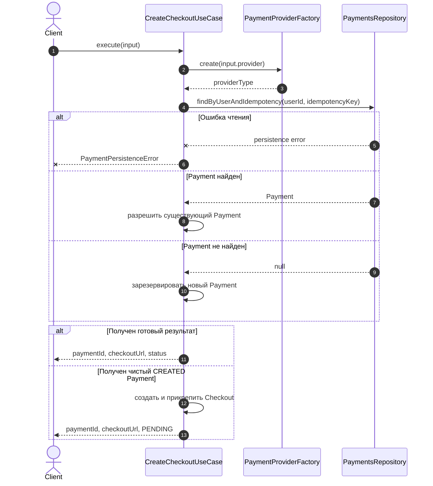
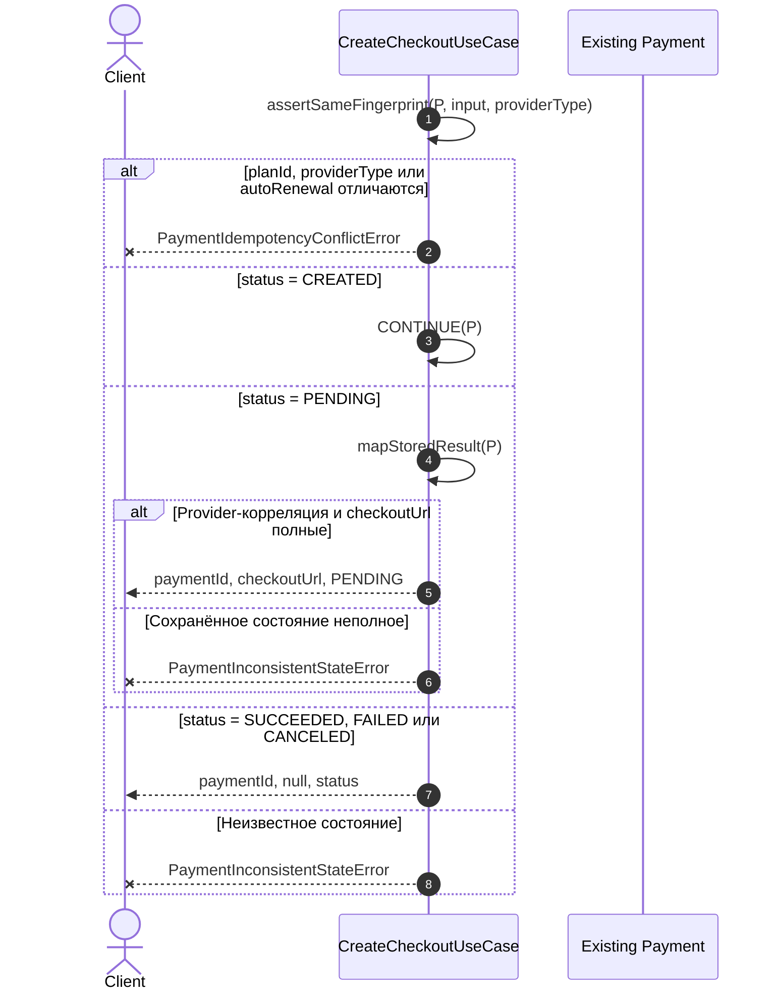
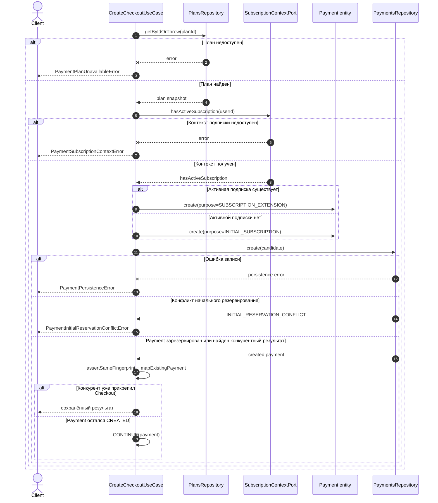
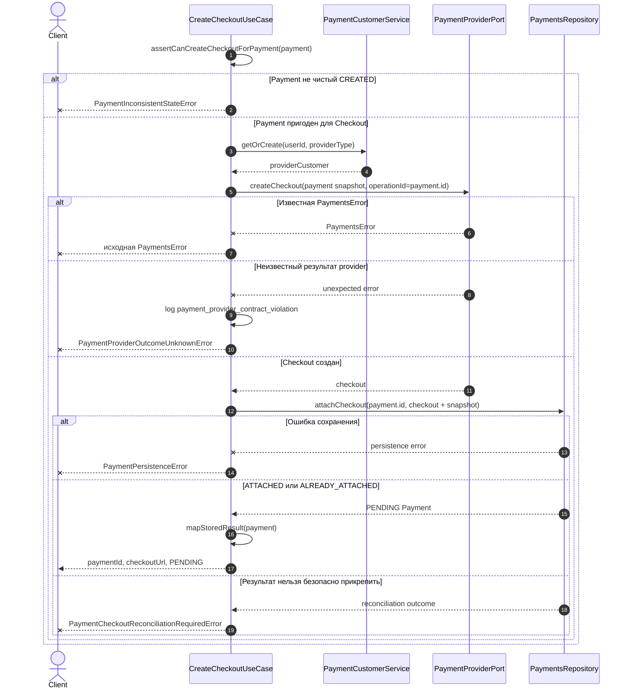

# CreateCheckoutUseCase

[Код](../../../../apps/payments/src/features/payments/application/use-cases/create-checkout.use-case.ts)

Это самостоятельный application use case, запускаемый клиентским запросом. Он не входит
в `DbosPaymentWebhookWorkflow`: webhook workflow позднее обрабатывает события уже созданного
Checkout.

Вход: `userId`, `planId`, `idempotencyKey`, `provider`, `autoRenewal`.

Выход: `paymentId`, `checkoutUrl`, `status`.

## 1. Маршрутизация запроса

`execute` определяет provider и делегирует разрешение Payment. Ранний результат возвращается
без обращения к provider. Только чистый `CREATED` Payment переходит к созданию Checkout.

## 2. Повторный запрос: существующий Payment

Одинаковый `Idempotency-Key` может продолжать только исходное намерение пользователя.
Fingerprint проверяется до любого раннего возврата. Сохранённые `checkoutPurpose` и контекст
подписки повторно не вычисляются.

Новый Checkout для `SUCCEEDED`, `FAILED` или `CANCELED` Payment не создаётся: повторное
использование той же записи сделало бы snapshot и время оплаты противоречивыми.

## 3. Первый запрос: резервирование нового Payment

`SubscriptionContextPort` возвращает только boolean. Payments самостоятельно фиксирует
назначение Checkout и не получает от Subscriptions локальный `subscriptionId`.

## 4. Создание и прикрепление Checkout

Внешняя операция разрешена только для чистого `CREATED` Payment без частично сохранённой
provider-корреляции. Частичное состояние требует reconciliation, а не повторного создания
финансовой операции.

## Инварианты

- `idempotencyKey` адресует одно исходное намерение пользователя.
- Fingerprint состоит из `planId`, `providerType` и `autoRenewal`.
- `checkoutPurpose` вычисляется только при создании Payment и не пересчитывается при replay.
- Provider Checkout создаётся только для чистого `CREATED` Payment.
- `operationId = payment.id` связывает идемпотентность внешней операции с локальным Payment.
- Успешный ответ возвращается только из проверенного сохранённого состояния `PENDING`.
- Неопределённый provider outcome и частичная корреляция требуют reconciliation.
