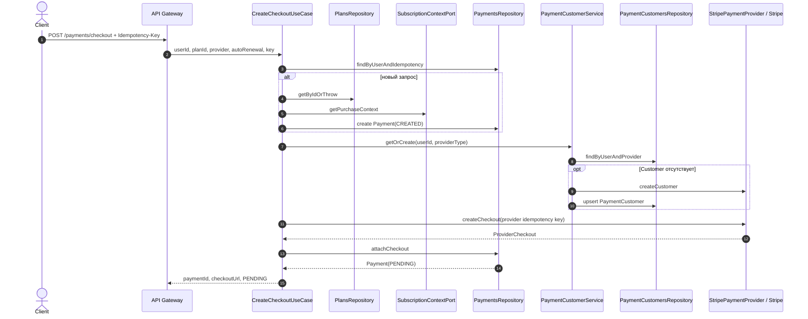
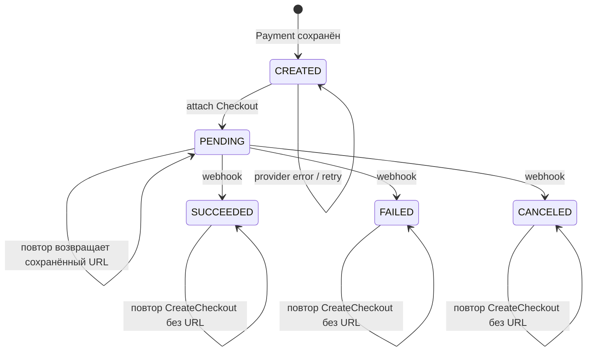

# Фактически реализованный workflow `CreateCheckout`

## 1. Статус и границы документа

Этот документ фиксирует **реальное состояние кода на коммите `f9f4dd5`** после изменений
`2994e3b`, `ed30911`, `4155fd5`, `591159f` и `f9f4dd5`. Он не заменяет целевые документы
`payment-checkout-webhook-specification.md` и `initial-subscription-payment-flow.md`:

- целевые документы описывают полный Checkout/webhook/subscription lifecycle;
- здесь описан только уже реализованный синхронный путь создания Checkout, его локальная
  идемпотентность, provider-вызовы и сохранение корреляции;
- webhook и применение успешного платежа упоминаются лишь там, где их состояние влияет на
  повторный `CreateCheckout` и initial reservation.

Проверенными источниками являются application/domain/infrastructure-код, Prisma schema,
миграции и тесты репозитория. Формулировки ниже относятся к текущему коду, а не к желаемому
финальному дизайну.

## 2. Что уже реализовано

Реализованы:

1. HTTP `POST /payments/checkout` в API Gateway и gRPC `CreateCheckout` в Payments.
2. Обязательный пользовательский `Idempotency-Key` (UUID v4), нормализуемый в lowercase.
3. Серверный snapshot плана в `Payment`: `amount`, `currency`, `periodCount`, `periodUnit`.
4. Разделение `PaymentType.PURCHASE` и `CheckoutPurpose`:
   `INITIAL_SUBSCRIPTION` / `SUBSCRIPTION_EXTENSION`.
5. Уникальность `(userId, idempotentKey)` и атомарное разрешение concurrent create.
6. Partial unique index, резервирующий единственную незавершённую initial purchase пользователя.
7. `PaymentCustomer` с уникальностью `(userId, providerType)` и
   `(providerType, providerCustomerId)`.
8. Stripe Customer и Stripe Checkout с детерминированными provider idempotency keys.
9. Stripe Checkout `mode=subscription` для initial и `mode=payment` для extension.
10. Атомарный conditional attach Checkout к `Payment`, включая повторный attach и конфликты.
11. Классификация provider-ошибок на `VALIDATION_ERROR`, `UNAVAILABLE`, `UNKNOWN`.
12. Стабильные application error codes и их отображение в gRPC/HTTP.

Не реализованы в этом workflow: reconciliation неизвестного результата, автоматическое
освобождение зависшего резерва, реальный источник subscription context, а также полноценный
end-to-end extension flow в текущем wiring.

## 3. Участники и данные

Основная цепочка:



### `Payment` до Stripe

`Payment.create` создаёт `PaymentType.PURCHASE`, `PaymentStatus.CREATED` и immutable snapshot
плана. Для initial `targetSubscriptionId=null`; для extension он обязателен. Provider-поля,
`providerCustomerId`, `checkoutExpiresAt` и `providerSnapshot` изначально `null`.

### Request fingerprint

Фактически fingerprint не хранится отдельным hash. При каждом повторе
`assertSameFingerprint` сравнивает только:

```text
planId + providerType + autoRenewalRequested
```

`userId` и `idempotentKey` уже входят в ключ поиска. Цена, валюта, период,
`checkoutPurpose` и `targetSubscriptionId` берутся из первой сохранённой записи и при повторе
не пересчитываются. Поэтому изменение Plan после первой попытки не меняет snapshot и не создаёт
конфликт; изменение subscription context также не меняет назначение существующего `Payment`.

### Provider idempotency keys

```text
Stripe Customer: customer:create:{internalUserId}
Stripe Checkout: checkout:{providerType}:{paymentId}
```

Оба ключа формируются сервером. Пользовательский ключ не передаётся Stripe напрямую.

## 4. Initial reservation

Initial reservation реализован partial unique index `payments_active_initial_subscription_key`
по `userId` для строк:

```text
checkoutPurpose = INITIAL_SUBSCRIPTION
AND (
  status IN (CREATED, PENDING)
  OR (status = SUCCEEDED AND subscriptionId IS NULL)
)
```

Следствия:

- `CREATED` и `PENDING` удерживают резерв;
- `SUCCEEDED` удерживает его до появления `subscriptionId`;
- `FAILED` и `CANCELED` резерв не удерживают;
- `SUCCEEDED` с `subscriptionId != null` резерв не удерживает;
- ограничение атомарно на PostgreSQL, а не основано на предварительном read.

При unique conflict `PrismaPaymentsRepository.create` сначала ищет победителя по
`(userId, idempotentKey)`. Если он найден, возвращает `IDEMPOTENCY_CONFLICT` с этой записью.
Иначе для initial ищет активный резерв и возвращает `INITIAL_RESERVATION_CONFLICT`. Необъяснённый
`P2002` пробрасывается и на application-границе становится `PaymentPersistenceError`.

## 5. `PaymentCustomer`

`PaymentCustomerService.getOrCreate`:

1. Ищет запись по `(userId, providerType)`.
2. Если запись есть, возвращает её без provider-вызова.
3. Если записи нет, вызывает `createCustomer({internalUserId})`.
4. Stripe использует `customer:create:{internalUserId}`; concurrent/retry вызовы должны получить
   один Stripe Customer.
5. Репозиторий выполняет `upsert` по `(userId, providerType)` с пустым `update`.
6. Если сохранённый `providerCustomerId` отличается от только что полученного, выбрасывается
   `PaymentCheckoutReconciliationRequiredError`.

Локальная запись Customer не связана FK с `Payment`: в текущей схеме Checkout сохраняет только
`Payment.providerCustomerId` при attach.

## 6. Stripe Checkout

Для `INITIAL_SUBSCRIPTION` создаётся Stripe Checkout Session:

- `mode: subscription`;
- inline recurring `price_data` из snapshot плана;
- `customer` из `PaymentCustomer`;
- `metadata.paymentId`, `subscription_data.metadata.paymentId` и
  `client_reference_id=paymentId`.

Для `SUBSCRIPTION_EXTENSION`:

- `mode: payment`;
- inline one-time `price_data`;
- `metadata.paymentId`, `payment_intent_data.metadata.paymentId` и
  `client_reference_id=paymentId`.

При успехе адаптер возвращает `ProviderCheckout`: `checkoutId`, URL, возможные Stripe IDs,
`providerCustomerId`, expiry и компактный snapshot. Если `session.url` отсутствует, результат
классифицируется как `UNKNOWN`.

## 7. Conditional/idempotent attach

`PrismaPaymentsRepository.attachCheckout` выполняет одну DB-транзакцию:

1. `updateMany` меняет строку только при `id=paymentId`, `status=CREATED` и
   `providerCheckoutId=null`.
2. В одной операции сохраняются все provider IDs, Customer ID, expiry, snapshot и
   `status=PENDING`.
3. Затем строка читается внутри той же транзакции и результат классифицируется:

| Условие | `AttachCheckoutResult` |
|---|---|
| update изменил одну строку | `ATTACHED` |
| строка уже содержит тот же `checkoutId` | `ALREADY_ATTACHED` |
| строка содержит другой `providerCheckoutId` | `CHECKOUT_CONFLICT` |
| строка отсутствует | `PAYMENT_NOT_FOUND` |
| строка есть, но attach невозможен по другому состоянию | `INVALID_STATE` |
| нарушена уникальность provider reference | `PROVIDER_REFERENCE_CONFLICT` с reference |

Unique constraints существуют для checkout, payment и invoice references. В текущей Prisma
schema нет unique constraint для `providerSubscriptionId`, хотя классификатор умеет назвать
`SUBSCRIPTION`; это расхождение отмечено как ограничение.

Use case возвращает результат только для `ATTACHED`/`ALREADY_ATTACHED`. Любой другой типизированный
attach outcome становится `PaymentCheckoutReconciliationRequiredError`. Исключение БД становится
`PaymentPersistenceError`.

## 8. Состояния при повторном `CreateCheckout`



Для `PENDING` результат допустим только если одновременно присутствуют
`providerCheckoutId`, `providerCustomerId`, `checkoutExpiresAt` и непустой
`providerSnapshot.checkoutUrl`. Иначе возникает `PaymentInconsistentStateError`.

Для чистого `CREATED` повтор снова проходит Customer/Stripe/attach. Если у `CREATED` уже есть
любая provider-корреляция, Customer ID, expiry или snapshot, это считается inconsistent state:
новая внешняя операция не создаётся.

## 9. Классификация provider-ошибок и retry

`StripePaymentProvider.classifyOperationError` использует следующую классификацию:

| Stripe/адаптерный результат | Outcome | Application при Checkout | Статус `Payment` | Retry |
|---|---|---|---|---|
| `StripeInvalidRequestError`, `StripeIdempotencyError` | `VALIDATION_ERROR` | `PaymentProviderValidationError` | `CREATED` | технически разрешён тем же key; вероятно повторит ошибку |
| `StripeAPIError`, `StripeRateLimitError` | `UNAVAILABLE` | `PaymentProviderUnavailableError` | `CREATED` | да, тем же key |
| `StripeConnectionError` | `UNKNOWN` | `PaymentProviderOutcomeUnknownError` | `CREATED` | да, только тем же key |
| неизвестное исключение | `UNKNOWN` | `PaymentProviderOutcomeUnknownError` | `CREATED` | да, тем же key |
| адаптер нарушил контракт и бросил исключение | — | `PaymentProviderOutcomeUnknownError` | `CREATED` | да, тем же key; ошибка логируется |

Важно: `VALIDATION_ERROR` после `f9f4dd5` **не** переводит `Payment` в `FAILED`. Это сознательно
отличается от промежуточной реализации после `4155fd5`. Любая ошибка создания Checkout не считается
доказанным финансовым результатом.

Для Customer `UNAVAILABLE` и `VALIDATION_ERROR` сворачиваются в
`PaymentCustomerProviderError`; `UNKNOWN` и неожиданное исключение — в
`PaymentProviderOutcomeUnknownError`. В обоих случаях `Payment` остаётся `CREATED`.

## 10. Сценарии выполнения

### 10.1. Новый initial subscription checkout

**Preconditions:** валидный новый key; Plan существует; контекст — `FIRST_PURCHASE`; активного
initial reservation нет.

**Последовательность:** lookup key → Plan → context → `Payment.create` с
`INITIAL_SUBSCRIPTION` → атомарный insert `CREATED` → get/create Customer → Stripe
`mode=subscription` → conditional attach.

**Результат:** `Payment=PENDING`; `{paymentId, checkoutUrl, status:PENDING}`.

**Retry:** тот же key безопасен; после attach возвращается сохранённый URL.

### 10.2. Новая subscription extension

**Preconditions:** контекст — `ADDITIONAL_PURCHASE` с `subscriptionId`; новый key.

**Последовательность:** создаётся `PURCHASE/CREATED` с
`checkoutPurpose=SUBSCRIPTION_EXTENSION` и `targetSubscriptionId`; Stripe вызывается с
`mode=payment`; затем attach.

**Результат:** `Payment=PENDING`, URL возвращается.

**Retry:** как для initial, но partial initial-reservation index extension не ограничивает.

**Текущее ограничение:** production DI использует `TemporarySubscriptionContextAdapter`, который
всегда возвращает `FIRST_PURCHASE`; следовательно эта ветка в текущем приложении фактически
недостижима, хотя домен, use case и Stripe adapter её поддерживают.

### 10.3. Повтор с тем же key и тем же fingerprint

**Preconditions:** найден `Payment` того же пользователя; совпадают `planId`, `providerType`,
`autoRenewalRequested`.

| Текущий статус | Действие | Ответ/error | Retry |
|---|---|---|---|
| `CREATED` чистый | Customer → Stripe с тем же provider key → attach | обычно `PENDING`; provider error по классификации | да |
| `PENDING` консистентный | внешние вызовы не выполняются | сохранённые `paymentId`, URL, `PENDING` | да, replay |
| `SUCCEEDED` | внешние вызовы не выполняются | тот же `paymentId`, `checkoutUrl:null`, `SUCCEEDED` | replay состояния |
| `FAILED` | внешние вызовы не выполняются | тот же `paymentId`, `checkoutUrl:null`, `FAILED` | новый Checkout этим key невозможен |
| `CANCELED` | внешние вызовы не выполняются | тот же `paymentId`, `checkoutUrl:null`, `CANCELED` | новый Checkout этим key невозможен |

Неконсистентные `CREATED`/`PENDING` дают `PaymentInconsistentStateError`.

### 10.4. Тот же key с другим fingerprint

**Preconditions:** `(userId, idempotentKey)` найден, но отличается хотя бы одно из
`planId/providerType/autoRenewalRequested`.

**Последовательность:** конфликт проверяется до status replay и до любых provider-вызовов.

**Результат:** существующий `Payment` не меняется;
`PaymentIdempotencyConflictError` (`PAYMENT_IDEMPOTENCY_CONFLICT`).

**Retry:** только с исходным fingerprint либо с новым key для нового намерения.

### 10.5. Два конкурентных запроса с одинаковым key

**Preconditions:** записи ещё нет, fingerprint одинаков.

**Последовательность:** оба могут пройти initial lookup; unique `(userId,idempotentKey)` допускает
один insert. Проигравший получает из repository сохранённого победителя как
`IDEMPOTENCY_CONFLICT`; use case повторно проверяет fingerprint. Оба могут затем вызвать Customer и
Stripe, но используют одинаковые детерминированные provider keys. Conditional attach допускает один
`ATTACHED`, второй — `ALREADY_ATTACHED` для той же Session.

**Результат:** одна строка `Payment`, обычно `PENDING`; оба запроса возвращают одну операцию.

**Retry:** да. Если provider нарушит idempotency и вернёт разные Session, один attach победит, второй
получит reconciliation error.

### 10.6. Разные keys при занятом initial reservation

**Preconditions:** пользователь имеет initial `CREATED`/`PENDING` либо `SUCCEEDED` без
`subscriptionId`; новый запрос тоже классифицирован как initial.

**Последовательность:** новый insert нарушает partial unique index; repository не находит запись по
новому key, находит reservation и возвращает `INITIAL_RESERVATION_CONFLICT`.

**Результат:** новая строка и Stripe Session не создаются;
`PaymentInitialReservationConflictError`; существующий статус без изменений.

**Retry:** новый key не поможет, пока резерв не выйдет из predicate индекса.

### 10.7. Успешное создание Stripe Session и attach

**Preconditions:** чистый `CREATED`, Customer разрешён, Stripe вернул Session с URL.

**Последовательность:** provider result дополняется `snapshot.checkoutUrl`; транзакция сохраняет
все references и меняет `CREATED→PENDING`.

**Результат:** `PENDING`, URL из сохранённого snapshot.

**Retry:** replay без Stripe-вызова.

### 10.8. Повторный attach той же Session

**Preconditions:** Payment уже содержит тот же `providerCheckoutId`.

**Последовательность:** conditional update не проходит; transaction читает строку и возвращает
`ALREADY_ATTACHED`.

**Результат:** данные не перезаписываются; use case возвращает сохранённый `PENDING` результат.

**Retry:** безопасен.

### 10.9. Attach другой Session / provider reference conflict

**Preconditions:** Payment уже содержит другой checkout либо новый provider reference уникально
принадлежит другой строке.

**Последовательность:** первый случай даёт `CHECKOUT_CONFLICT`; unique collision —
`PROVIDER_REFERENCE_CONFLICT` (`CHECKOUT`, `PAYMENT`, `INVOICE` или `UNKNOWN`).

**Результат:** исходная корреляция не перезаписывается; use case возвращает
`PaymentCheckoutReconciliationRequiredError`; status обычно остаётся прежним (`PENDING` у уже
attached или `CREATED` у проигравшей строки).

**Retry:** слепой retry не разрешает конфликт; требуется reconciliation/операторская проверка.

### 10.10. Deterministic provider validation error

**Preconditions:** Stripe возвращает `StripeInvalidRequestError` или `StripeIdempotencyError`.

**Последовательность:** adapter → `VALIDATION_ERROR` → `PaymentProviderValidationError`.

**Результат:** `Payment` остаётся `CREATED`; provider correlation не сохраняется.

**Retry:** код разрешает повтор с тем же key, но без изменения причины ожидается та же ошибка.
Другой key может создать дополнительный `Payment` только для extension; initial будет остановлен
собственным `CREATED` reservation.

### 10.11. Transient provider unavailable

**Preconditions:** Stripe `StripeAPIError` или `StripeRateLimitError` при Checkout.

**Последовательность:** adapter → `UNAVAILABLE` → `PaymentProviderUnavailableError`.

**Результат:** `CREATED`, HTTP 503.

**Retry:** да, с тем же пользовательским key; Stripe получит тот же provider key.

### 10.12. Timeout/network unknown outcome

**Preconditions:** `StripeConnectionError`, отсутствие Session URL, неизвестное исключение или
нарушение provider port contract.

**Последовательность:** результат `UNKNOWN` либо catch use case →
`PaymentProviderOutcomeUnknownError`.

**Результат:** локально `CREATED`; неизвестно, создана ли Session в Stripe; HTTP 502 из-за
отсутствия отдельного HTTP mapping для gRPC `ABORTED`.

**Retry:** только с тем же key. Stripe idempotency должен вернуть ту же операцию; автоматического
lookup/reconciliation по Stripe в коде нет.

### 10.13. Ошибка локального persistence/attach

**Preconditions:** lookup/insert/Customer upsert/attach бросает инфраструктурное исключение.

**Последовательность:** ошибка нормализуется в `PaymentPersistenceError`. Attach транзакционен:
частичное обновление полей не должно сохраниться.

**Результат:** HTTP 502 (gRPC `INTERNAL` попадает в default gateway mapping). Если Stripe Session
уже создана, внешний результат может существовать без подтверждённой локальной корреляции.

**Retry:** тем же key. Если attach commit не произошёл, Stripe key должен вернуть ту же Session и
attach повторится; если commit произошёл, а ответ БД потерян, следующий lookup увидит `PENDING` и
вернёт сохранённое. Автоматического reconciliation для длительной рассинхронизации нет.

### 10.14. Конфликт или неоднозначность `PaymentCustomer`

**Preconditions:** Customer отсутствовал локально; concurrent запросы либо локальный winner имеет
другой `providerCustomerId`.

**Последовательность:** одинаковый Stripe key должен дедуплицировать concurrent create; локальный
`upsert` выбирает одну строку. После upsert сервис сравнивает сохранённый ID с provider response.

**Результат:** при совпадении продолжается Checkout; при несовпадении —
`PaymentCheckoutReconciliationRequiredError`, `Payment` остаётся `CREATED`. Ошибка чтения/upsert —
`PaymentPersistenceError`; Customer provider validation/unavailable —
`PaymentCustomerProviderError`; unknown — `PaymentProviderOutcomeUnknownError`.

**Retry:** при transient/unknown — тем же key; при различающихся Customer IDs требуется
reconciliation. Код не выбирает автоматически, какой Customer считать истинным.

## 11. Error mapping application → gRPC → HTTP

Ниже перечислены ошибки, непосредственно релевантные `CreateCheckout`:

| Application code | gRPC | HTTP |
|---|---:|---:|
| `INVALID_PAYMENT_PROVIDER`, `INVALID_PAYMENT_IDEMPOTENT_KEY` | `INVALID_ARGUMENT` | 400 |
| `PLAN_NOT_FOUND` | `NOT_FOUND` | 404 |
| `PAYMENT_IDEMPOTENCY_CONFLICT` | `ALREADY_EXISTS` | 409 |
| `PAYMENT_INITIAL_RESERVATION_CONFLICT` | `ALREADY_EXISTS` | 409 |
| `PAYMENT_CHECKOUT_RECONCILIATION_REQUIRED` | `FAILED_PRECONDITION` | 409 |
| `PAYMENT_INCONSISTENT_STATE` | `FAILED_PRECONDITION` | 409 |
| `PAYMENT_PROVIDER_VALIDATION_FAILED` | `INVALID_ARGUMENT` | 400 |
| `PAYMENT_PROVIDER_UNAVAILABLE` | `UNAVAILABLE` | 503 |
| `PAYMENT_CUSTOMER_PROVIDER_FAILED` | `UNAVAILABLE` | 503 |
| `PAYMENT_SUBSCRIPTION_CONTEXT_FAILED` | `UNAVAILABLE` | 503 |
| `PAYMENT_PLAN_UNAVAILABLE` | `UNAVAILABLE` | 503 |
| `PAYMENT_PROVIDER_OUTCOME_UNKNOWN` | `ABORTED` | 502 (fallback) |
| `PAYMENT_PERSISTENCE_FAILED` | `INTERNAL` | 502 (fallback) |

HTTP 502 здесь не является отдельным бизнес-решением: API Gateway не содержит явных mappings для
`ABORTED` и `INTERNAL`, поэтому использует `BAD_GATEWAY` по умолчанию.

## 12. Отличия фактической реализации от целевой спецификации

1. Extension model реализована, но реальный `SubscriptionContextPort` ещё не подключён; все новые
   покупки считаются initial.
2. После deterministic provider validation `Payment` остаётся `CREATED`, а не `FAILED`.
3. `FAILED`/`CANCELED` при повторе того же key только возвращаются как терминальный result; повторное
   создание Checkout для этой записи отсутствует.
4. Reconciliation описан как необходимый, но job/API для него не реализованы.
5. Timeout/unknown outcome полагается на Stripe idempotency при клиентском retry; proactive lookup
   Session отсутствует.
6. Reservation для `CREATED` не имеет TTL. Истёкший/навсегда ошибочный initial может блокировать
   новые keys, пока статус не изменён внешним процессом.
7. В `Payment` нет `applicationStatus`, хотя целевая спецификация разделяет финансовое состояние и
   применение к Subscription.
8. `providerSubscriptionId` не уникален в текущей Prisma schema, несмотря на наличие классификации
   такого unique conflict в repository.
9. Fingerprint — прямое сравнение трёх полей, не сохранённый canonical hash полного запроса.
10. `PaymentCustomer` не связан с `Payment` через локальный `customerId`; сохраняется только provider ID.
11. Customer errors менее детальны: validation и unavailable объединены в
    `PAYMENT_CUSTOMER_PROVIDER_FAILED`.
12. gRPC `ABORTED` для unknown outcome превращается в общий HTTP 502, а не в отдельный явно
    задокументированный retryable HTTP status.

## 13. Текущие ограничения и открытые вопросы

### Подтверждённые ограничения

- Только Stripe фактически поддерживается provider factory; схема содержит `PAYPAL`, но adapter flow
  для него отсутствует.
- Изменение Plan после создания `Payment` не влияет на сохранённый snapshot — это правильно для
  финансовой неизменяемости, но не входит в fingerprint.
- `autoRenewalRequested` сохраняется, но создание Checkout сейчас не меняет Stripe параметры в
  зависимости от `true/false`.
- Нет локальной lease/attempt metadata для оркестрации `CREATED` retry.
- Нет гарантированного способа восстановить URL, если Stripe Session создана, а локальный attach
  систематически не проходит.
- Неконсистентный `PENDING` нельзя автоматически исправить через `CreateCheckout`.

### Открытые вопросы, влияющие на финансовое поведение

1. Должна ли deterministic `VALIDATION_ERROR` оставлять initial reservation навсегда, переводить
   `Payment` в `FAILED` или требовать отдельной операторской/reconciliation команды? Текущий код
   оставляет `CREATED` и тем самым блокирует другой initial key.
2. Каков источник истины и протокол разрешения конфликта, если Stripe по одному user key и локальная
   `PaymentCustomer` указывают на разные Customer IDs? Текущий код лишь останавливает workflow.
3. Нужно ли добавить unique `(providerType, providerSubscriptionId)`? Сейчас две строки могут иметь
   одну Stripe Subscription reference.
4. Как и когда освобождать initial reservation после неизвестного outcome или истёкшей Session, если
   webhook/reconciliation не дошёл?
5. Какой HTTP контракт должен явно представлять `PAYMENT_PROVIDER_OUTCOME_UNKNOWN`: 409, 502, 503 или
   иной retryable ответ? Сейчас это неявный 502 fallback.
6. Должен ли `autoRenewalRequested=false` менять initial Stripe Subscription уже при Checkout либо
   применяться позже после webhook? В текущем create flow это поле на Stripe request не влияет.
