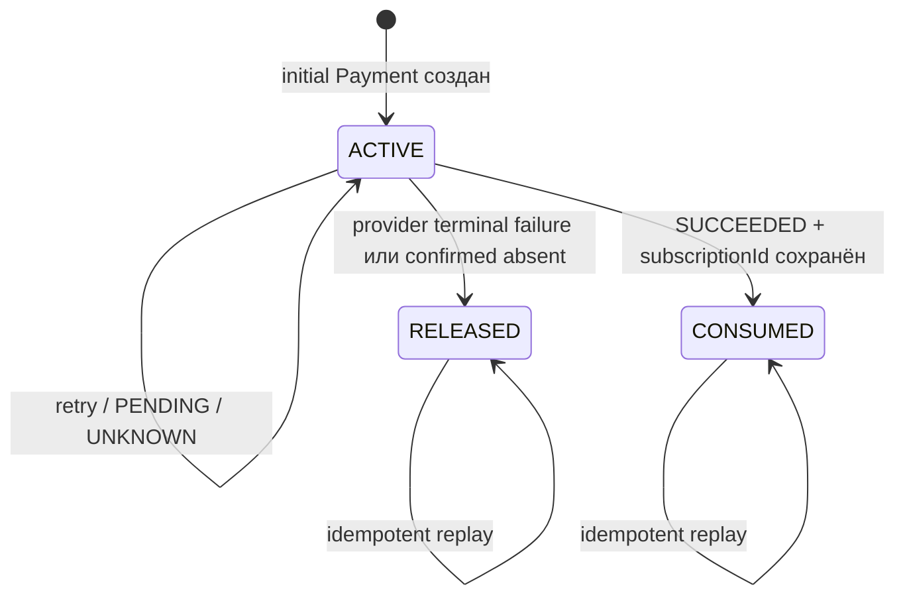

# План освобождения initial reservation

## 1. Цель

Документ планирует следующий этап после реализации `CreateCheckout`: определить, **когда** и
**каким атомарным действием** освобождать право пользователя на единственный незавершённый
`INITIAL_SUBSCRIPTION` checkout.

План опирается на фактическое состояние кода на `f9f4dd5`, описанное в
`create-checkout-implemented-workflow.md`. Это проект решения, а не описание уже реализованного
поведения.

## 2. Проблема текущей модели

Сейчас reservation не является отдельным состоянием. Его наличие выводится из partial unique
index:

```text
checkoutPurpose = INITIAL_SUBSCRIPTION
AND (
  status IN (CREATED, PENDING)
  OR (status = SUCCEEDED AND subscriptionId IS NULL)
)
```

Из-за этого:

- зависший `CREATED` блокирует все новые initial keys без ограничения времени;
- нельзя освободить reservation, не меняя финансовый `Payment.status`;
- `VALIDATION_ERROR` оставляет `Payment=CREATED`, поэтому reservation остаётся навсегда;
- timeout, потерянный attach и фактическое отсутствие Stripe Session выглядят одинаково;
- после административного освобождения старый retry теоретически может снова создать Checkout;
- время само по себе ошибочно использовать как доказательство, что Stripe Session не создана или
  не оплачена.

## 3. Главный инвариант

После освобождения reservation исходный `Payment` **никогда больше не должен создавать или
attach-ить Checkout**.

Иначе возможна гонка:

```text
старый Payment освобождён
→ новый key получил reservation и создал Stripe Subscription Checkout
→ поздний retry старого key тоже создал/восстановил Checkout
→ у пользователя две initial Stripe Subscription
```

Следовательно, release — терминальное решение именно для checkout orchestration старого
`Payment`, даже если его финансовый `Payment.status` остаётся `CREATED`.

## 4. Рекомендуемая модель

### 4.1. Не использовать `Payment.status` как reservation state

`Payment.status` должен продолжать описывать финансовый результат. Для reservation требуется
отдельное поле:

```ts
enum InitialReservationStatus {
  ACTIVE
  RELEASED
  CONSUMED
}
```

- `ACTIVE` — только этот `Payment` имеет право продолжать initial checkout workflow;
- `RELEASED` — операция закрыта без создания локальной Subscription, новый key разрешён;
- `CONSUMED` — успешный Payment применён и `subscriptionId` надёжно сохранён.

Для `SUBSCRIPTION_EXTENSION` и `RENEWAL` значение должно быть `null`.

Минимальные audit-поля:

```text
initialReservationStatus
initialReservationReleasedAt
initialReservationReleaseReason
```

Рекомендуемые release reasons:

```text
CHECKOUT_EXPIRED
PAYMENT_FAILED
PROVIDER_REJECTED_BEFORE_CREATION
RECONCILIATION_CONFIRMED_ABSENT
OPERATOR_CONFIRMED_SAFE
```

`CONSUMED` не является release reason: это успешное завершение reservation lifecycle.

### 4.2. Новый partial unique index

```sql
UNIQUE (user_id)
WHERE checkout_purpose = 'INITIAL_SUBSCRIPTION'
  AND initial_reservation_status = 'ACTIVE'
```

Индекс остаётся последней атомарной защитой от двух активных initial operations. Application read
не заменяет этот constraint.

### 4.3. Сохранённый terminal checkout outcome

Для replay старого idempotency key после `RELEASED` нужен устойчивый результат. Следует либо добавить
checkout orchestration state, либо сохранить terminal error code отдельно. Минимальный вариант:

```text
checkoutCreationStatus = READY | ATTACHED | CLOSED
checkoutClosureCode
checkoutClosedAt
```

Правила:

- `READY`: разрешён provider create/retry;
- `ATTACHED`: provider correlation сохранена, повтор возвращает URL/status;
- `CLOSED`: provider create/attach запрещены, повтор возвращает сохранённый terminal outcome.

`CLOSED` необходим даже при `Payment.status=CREATED`: именно он не допускает оживления старой
операции после release.

## 5. Когда reservation освобождается

| Ситуация | Решение | Основание |
|---|---|---|
| Новый initial `Payment` | `ACTIVE` | Атомарный insert выиграл unique constraint |
| Stripe Session attached, `PENDING` | оставить `ACTIVE` | Session может быть оплачена |
| Проверенный `checkout.session.expired` | `RELEASED` | Провайдер подтвердил окончание Session |
| Проверенный terminal payment failure | `RELEASED` | Provider operation достоверно завершена без успеха |
| `SUCCEEDED`, `subscriptionId=null` | оставить `ACTIVE` | Нельзя допустить вторую initial покупку до применения первой |
| `SUCCEEDED` и Subscription связана | `CONSUMED` | Initial purchase завершена локально |
| Provider timeout/network `UNKNOWN` | оставить `ACTIVE` | Неизвестно, создана ли Session |
| Ошибка локального attach/persistence | оставить `ACTIVE` | Session могла быть создана |
| Transient provider unavailable | оставить `ACTIVE` | Та же операция должна быть повторена |
| Детерминированный отказ, доказано что Session не создана | `RELEASED` + checkout `CLOSED` | Внешней финансовой операции нет |
| Reconciliation доказал отсутствие/terminal Session | `RELEASED` + checkout `CLOSED` | Есть provider evidence |
| Истёк внутренний таймер без provider evidence | **не освобождать** | Возраст записи не доказывает отсутствие оплаты |

### Важное уточнение по `VALIDATION_ERROR`

Текущий outcome слишком широкий для автоматического release: он объединяет как минимум разные
Stripe error classes. Provider port должен сообщать не просто «validation», а гарантию вида
`DEFINITELY_NOT_CREATED`. Только этот outcome разрешает немедленное закрытие workflow.

Если адаптер не может доказать, что операция не была создана, результат должен оставаться
`UNKNOWN`/`RECONCILIATION_REQUIRED`, а reservation — `ACTIVE`.

## 6. Когда выполнять release

### Синхронно

В той же DB-транзакции, где фиксируется достоверный terminal факт:

- обработка подписанного `checkout.session.expired`;
- обработка окончательного provider failure;
- provider вернул контракт `DEFINITELY_NOT_CREATED` до появления Checkout;
- Subscription linker сохранил `subscriptionId` — здесь выполняется `ACTIVE→CONSUMED`, не release.

### Асинхронно через reconciliation

Worker выбирает старые активные операции, но время используется только как условие проверки, а не
как причина release:

- `CREATED` старше короткого operational threshold;
- `PENDING` после `checkoutExpiresAt` плюс grace period;
- `SUCCEEDED` без `subscriptionId` старше application threshold;
- attach/provider reference conflict;
- `UNKNOWN` outcome или потерянный ответ provider.

Worker запрашивает provider по сохранённой корреляции, metadata `paymentId` или стабильному provider
idempotency key и затем:

- attach-ит найденную активную Session;
- применяет достоверный terminal status;
- освобождает reservation только при доказанном отсутствии/terminal результате;
- оставляет `ACTIVE` и поднимает alert, если результат по-прежнему неоднозначен.

Численные thresholds и grace period должны быть конфигурацией. Их нельзя зафиксировать до решения,
какой provider lookup доступен и как долго провайдер гарантирует восстановление по idempotency key.

## 7. Конкурентная безопасность

### 7.1. Release против retry старого key

Непосредственно перед provider call `CreateCheckout` должен атомарно подтвердить:

```text
checkoutCreationStatus = READY
AND initialReservationStatus = ACTIVE
```

После `RELEASED/CLOSED` тот же key возвращает сохранённый terminal outcome и не вызывает Stripe.

### 7.2. Reconciliation против выполняющегося provider call

Нужна короткая lease/claim-модель:

```text
checkoutLeaseToken
checkoutLeaseUntil
checkoutAttemptedAt
```

Release запрещён, пока действует lease. Истечение lease позволяет reconciliation начать проверку,
но само по себе не разрешает release. Это исключает освобождение reservation в момент, когда другой
процесс ещё ожидает ответ Stripe.

### 7.3. Release против нового key

Транзакция release сначала переводит старую запись `ACTIVE→RELEASED/CLOSED`. Только после commit новый
insert сможет пройти partial unique index. Если новый запрос пришёл раньше, он получает обычный
`PAYMENT_INITIAL_RESERVATION_CONFLICT` и может повториться.

### 7.4. Два releaser-а

Переход должен быть compare-and-set:

```text
UPDATE ...
WHERE id = paymentId
  AND initialReservationStatus = ACTIVE
  AND checkoutLease не действует
```

Повтор с тем же final evidence — idempotent no-op. Попытка применить другой release reason после
`RELEASED/CONSUMED` не перезаписывает первый terminal факт, а фиксируется как конфликт/метрика.

## 8. Предлагаемая машина состояний



Запрещены `RELEASED→ACTIVE`, `CONSUMED→ACTIVE` и `CONSUMED→RELEASED`. Новая попытка после release —
это новый `Payment` и новый пользовательский `Idempotency-Key`.

## 9. API-поведение

Повтор исходного key должен быть детерминированным:

| Reservation / checkout state | `CreateCheckout` |
|---|---|
| `ACTIVE/READY` | продолжить ту же операцию |
| `ACTIVE/ATTACHED` | вернуть сохранённый URL/status |
| `ACTIVE` + reconciliation required | вернуть retryable/operational error без нового provider create |
| `RELEASED/CLOSED` | вернуть сохранённый closure error; новый Checkout требует нового key |
| `CONSUMED` | вернуть terminal payment result без URL |

Нужен отдельный application code, например `PAYMENT_CHECKOUT_CLOSED`, чтобы клиент отличал:

- retry того же workflow;
- необходимость создать новое намерение с новым key;
- ручную/reconciliation блокировку.

Окончательное имя и HTTP mapping следует утвердить вместе с API-контрактом. Предварительно
`PAYMENT_CHECKOUT_CLOSED` логично отображать в gRPC `FAILED_PRECONDITION` и HTTP 409.

## 10. Поэтапная реализация

### Этап 1. Зафиксировать ADR и контракты

1. Утвердить отдельные reservation и checkout orchestration states.
2. Утвердить release reasons и API replay для закрытого key.
3. Разделить provider outcomes `DEFINITELY_NOT_CREATED`, `UNAVAILABLE`, `UNKNOWN`.
4. Определить provider lookup/reconciliation contract.
5. Согласовать thresholds, но не использовать их как финансовое доказательство.

### Этап 2. Миграция данных

1. Добавить enums/поля и новый partial unique index.
2. Backfill:
   - current initial `CREATED/PENDING` → `ACTIVE`;
   - `SUCCEEDED` без `subscriptionId` → `ACTIVE`;
   - `SUCCEEDED` с `subscriptionId` → `CONSUMED`;
   - `FAILED/CANCELED` → `RELEASED` с reason из статуса.
3. Проверить данные на конфликтующих active rows до создания индекса.
4. Удалить старый predicate index только после успешного backfill и установки нового constraint.

### Этап 3. Репозиторные атомарные операции

Добавить и покрыть PostgreSQL integration tests:

- `claimCheckoutAttempt`;
- `attachCheckout` только для `ACTIVE/READY`;
- `releaseInitialReservation(expectedState, reason, evidence)`;
- `consumeInitialReservation(paymentId, subscriptionId)`;
- concurrent release/new create;
- release/late attach;
- два concurrent releaser-а;
- retry старого key после release.

### Этап 4. Интеграция application flow

1. `CreateCheckoutUseCase` проверяет reservation/checkout state до Customer и provider calls.
2. Доказанный `DEFINITELY_NOT_CREATED` атомарно закрывает workflow и освобождает reservation.
3. `UNKNOWN`, unavailable и persistence failure сохраняют reservation.
4. Webhook terminal failure/expiry освобождает reservation в транзакции обработки события.
5. Успешное применение в Subscription атомарно сохраняет `subscriptionId` и переводит reservation
   в `CONSUMED`.

### Этап 5. Reconciliation worker

1. Выбор кандидатов с `FOR UPDATE SKIP LOCKED` либо эквивалентной lease-моделью.
2. Provider retrieve/search с audit evidence.
3. Идемпотентный attach/status/release.
4. Ограниченный retry с backoff.
5. Dead-letter/manual review для длительно неоднозначных операций.

### Этап 6. Наблюдаемость и rollout

Минимальные метрики:

```text
active_initial_reservations
active_initial_reservation_age_seconds
reservation_release_total{reason}
reservation_reconciliation_total{outcome}
checkout_unknown_outcome_total
checkout_lease_conflict_total
succeeded_without_subscription_total
```

Rollout выполнять сначала с shadow reconciliation: worker только классифицирует кандидатов и
пишет метрики, но не освобождает reservation. Автоматический release включать отдельно для каждого
доказанного outcome после проверки логов.

## 11. Критерии готовности

Решение можно считать готовым, когда доказаны следующие свойства:

1. У пользователя не бывает двух `ACTIVE` initial reservations.
2. Ни один timeout/возраст записи сам по себе не освобождает reservation.
3. После `RELEASED` старый key не вызывает Customer/Checkout provider methods.
4. Поздний attach не может оживить `RELEASED` Payment.
5. `SUCCEEDED` без `subscriptionId` продолжает блокировать новую initial покупку.
6. Сохранение `subscriptionId` и `ACTIVE→CONSUMED` не оставляет промежуточного окна.
7. Повтор webhook/reconciliation/release идемпотентен.
8. Все автоматические release имеют сохранённые reason, timestamp и provider evidence.
9. Неоднозначные случаи остаются `ACTIVE` и наблюдаемы, а не silently released.
10. Backfill не меняет финансовый `Payment.status`.

## 12. Открытые решения перед реализацией

1. Хранить reservation state непосредственно в `Payment` или выделить отдельную таблицу истории.
   Для текущей модели минимальным и достаточным является поле в `Payment`; отдельная таблица нужна,
   если потребуется несколько последовательных reservation epochs для одного Payment.
2. Какой точный Stripe lookup гарантирован для Session после unknown create: retrieve по известному ID,
   search по metadata или восстановление через provider idempotency semantics.
3. Какие provider errors действительно гарантируют `DEFINITELY_NOT_CREATED`.
4. Должен ли оператор иметь команду force release. Если да, она обязана требовать evidence/comment,
   быть audit-only и также закрывать старый checkout workflow.
5. Какой response body возвращать для `PAYMENT_CHECKOUT_CLOSED` и должен ли frontend автоматически
   генерировать новый key либо запрашивать явное новое действие пользователя.
6. Где проходит атомарная граница между сохранением `subscriptionId` в Payments и созданием
   Subscription в D2. До появления межсервисного transactional/outbox контракта reservation нельзя
   освобождать только по успешному ответу, который мог потеряться.
